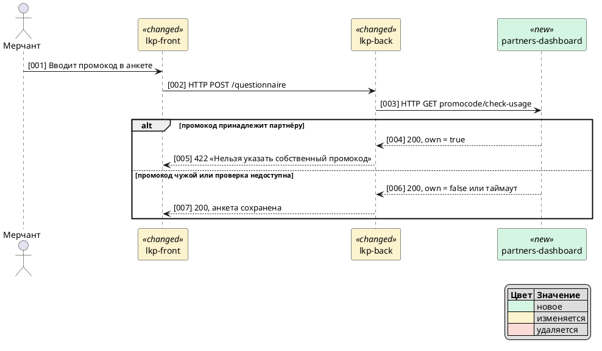
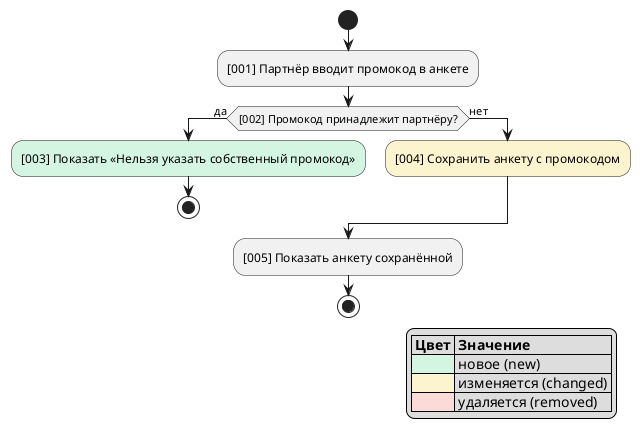
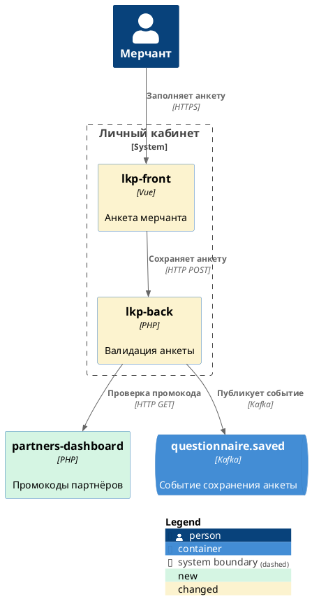
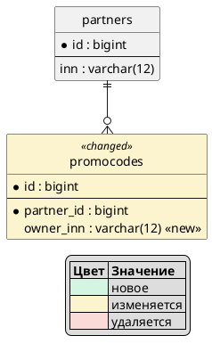
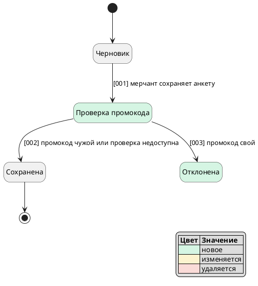

# SA Skills — подпроект 3: /tdd-draft, шаблон feature, блоки, puml-* — план реализации

> **For agentic workers:** REQUIRED SUB-SKILL: Use superpowers:subagent-driven-development (recommended) or superpowers:executing-plans to implement this plan task-by-task. Steps use checkbox (`- [ ]`) syntax for tracking.

**Goal:** Стадия 4 пайплайна: `/tdd-draft` собирает черновик ТЗ по манифесту шаблона `feature` из артефактов задачи, рисует диаграммы скилами `puml-*`, собирает `draft.md` и выдаёт отчёт о пробелах.

**Architecture:** Вся механика детерминирована и лежит в stdlib-скриптах: `sa_template.py` (манифест), `sa_draft.py` (план секций со срезами R/IM/D, сборка `draft.md`, отчёт о пробелах, учёт ручных правок по хэшам), `sa_puml.py` (структурная проверка диаграмм + `plantuml -syntax` локально или в Docker). Модель пишет только тексты секций `draft/<id>.md` и `.puml`, читая на каждую секцию лишь свой блок `shared/blocks/<блок>.md` и строки нужных ID. Валидатор проверяет секции, трассировку `‹…›`, плейсхолдеры `⚠ Q-xx` и что `draft.md` совпадает со сборкой.

**Tech Stack:** Claude Code plugin (SKILL.md), Python ≥ 3.10 (stdlib), pytest, PlantUML (необязательно).

**Spec:** `docs/superpowers/specs/2026-10-15-sa-skills-pipeline-design.md` (разделы 3, 5.4, 7, 10, 12)

## Global Constraints

- Скрипты в `scripts/` — только стандартная библиотека Python ≥ 3.10.
- Все тексты для пользователя — на русском.
- Скилы ссылаются на файлы плагина как `<плагин>/scripts/…` и `<плагин>/shared/…`, где `<плагин>` = `<база>/../..`.
- Каждый SKILL.md имеет frontmatter `name`, `description` (≤ 1024 символов), `allowed-tools: Bash(python3:*)`.
- В skills/agents/shared нет `$VAR`/`${VAR}` (тест `test_no_shell_variables_in_prompts`); в Bash — одна команда без `;`, `&&`, `|`.
- Файлы задачи скилы пишут по абсолютному пути `<tasks_dir>/<KEY>/…` из `sa_paths.py`; в командах скриптов — `tasks/<KEY>`.
- Источник истины по форматам — `shared/schemas/artifacts.md`; валидатор проверяет ровно то, что там написано.
- Существующие фикстуры (`tests/fixtures/LKP-DEMO`, `tests/fixtures/e2e`) не менять.
- Публикация — только в личное пространство Confluence через MCP; без MCP — файл `draft-publish.md` для ручной вставки (REST-публикация не входит в подпроект).
- Параллельные субагенты для больших секций не делаем (спек: «могут»), это отложено.

## Структура файлов

```
shared/
  blocks/                       # новые: scenarios changes api data errors roles
                                #        integrations nfr acceptance migration diagrams
  templates/feature.yaml        # новый манифест
  schemas/artifacts.md          # раздел «draft/ и draft.md», версия шаблона
  rules/artifact-writing.md     # + /tdd-draft в списке стадий
scripts/
  sa_template.py                # новый: разбор манифеста, `version <тип>`
  sa_puml.py                    # новый: проверка .puml
  sa_draft.py                   # новый: plan / assemble / gaps
  sa_validate.py                # + validate_draft
skills/
  tdd-draft/SKILL.md            # новый
  puml-c2/ puml-sequence/ puml-activity/ puml-er/ puml-state/SKILL.md   # новые
  tdd-start/SKILL.md            # версия из манифеста
  tdd-impact/ tdd-clarify/SKILL.md   # строка про абсолютные пути
tests/
  conftest.py                   # + write_sections, фикстура draft_task
  test_sa_template.py  test_sa_puml.py  test_sa_draft.py   # новые
  test_sa_validate.py  test_shared_docs.py  test_skills_contract.py   # дополнения
README.md
```

---

### Task 1: Блоки ТЗ (`shared/blocks/*.md`)

**Files:**
- Create: `shared/blocks/{scenarios,changes,api,data,errors,roles,integrations,nfr,acceptance,migration,diagrams}.md`
- Test: `tests/test_shared_docs.py`

**Interfaces:**
- Produces: 11 файлов блоков; имена (без `.md`) используются в манифесте (Task 2) как `block:`. Каждый блок имеет заголовки `## Когда`, `## Структура`, `## Правила`, `## Чек-лист` (чек-лист позже читает ревьюер SP4).

- [ ] **Step 1: Failing test** — дописать в конец `tests/test_shared_docs.py`:

```python
BLOCKS = ("scenarios", "changes", "api", "data", "errors", "roles", "integrations", "nfr", "acceptance", "migration", "diagrams")


@pytest.mark.parametrize("name", BLOCKS)
def test_block_has_headings(name):
    text = (ROOT / "shared/blocks" / f"{name}.md").read_text(encoding="utf-8")
    for heading in ("## Когда", "## Структура", "## Правила", "## Чек-лист"):
        assert f"\n{heading}\n" in text, f"{name}: нет заголовка {heading}"
    checklist = text.split("\n## Чек-лист\n", 1)[1]
    assert checklist.count("- [ ]") >= 3, f"{name}: в чек-листе меньше трёх пунктов"
```

- [ ] **Step 2:** `.venv/bin/pytest tests/test_shared_docs.py -q` → FAIL (нет файлов).

- [ ] **Step 3: Создать блоки** — точное содержимое ниже (внешние ```` ограничивают файл).

`shared/blocks/scenarios.md`:

````markdown
# Блок: сценарии

Секция `04-scenarios`. Общий стиль — `shared/rules/writing-style.md`.

## Когда

Всегда: ТЗ описывает, что делают пользователь или процесс после доработки.

## Структура

```markdown
### US-01. <короткое название>

Я, как <роль из BRD>, хочу <действие>, чтобы <ценность>. ‹R-01›

@diagram diagrams/04-scenarios-sequence.puml

Описание шагов:

1. [001] <кто> <что делает> [to be]. ‹IM-03›
2. [002] …

Альтернативы:

- [004] <условие> — <что происходит>. ‹R-01, D-01›
```

## Правила

- Одна US — один сценарий с точки зрения одной роли; роль — из BRD или `context.md`.
- Каждая US ссылается на `R-xx`; каждый `R-xx` типа `функц.` или `UI` покрыт хотя бы одной US.
- Шаги нумеруются трёхзначно и совпадают с номерами на диаграмме.
- Неизменное поведение — `[as is]`, новое — `[to be]`.
- Ветки ошибок и исключений перечисляются в «Альтернативах», подробности — в `09-errors`.
- Процесс без вызовов между сервисами — диаграмма `puml-activity`, со взаимодействием сервисов — `puml-sequence`.

## Чек-лист

- [ ] Каждая US в формате «Я, как …, хочу …, чтобы …» и со ссылкой на `R-xx`.
- [ ] Номера шагов в тексте и на диаграмме совпадают.
- [ ] У каждой ветки `alt` на диаграмме есть пункт в «Альтернативах».
- [ ] Нет ролей и сервисов, которых нет в BRD и `impact-map.md`.
````

`shared/blocks/changes.md`:

````markdown
# Блок: доработки по сервисам

Секция `05-changes` — ядро ТЗ «доработка».

## Когда

Всегда: каждый пункт карты влияния «в скоупе» с влиянием `новый`, `изм.` или `удал.` превращается в задачу на доработку.

## Структура

```markdown
### Сервис: `lkp-back`

Задача:

1. В правиле валидации промокода добавить проверку владельца промокода [to be]. ‹IM-02, R-01›
2. При недоступности проверки сохранять анкету без проверки [to be]. ‹IM-02, R-03, D-02›

Примечание: правило применяется только к новым анкетам. ‹D-01›
```

## Правила

- Один подраздел на сервис; сервисы — только из колонки «Объект» строк `impact-map.md` в скоупе.
- Порядок подразделов — по ходу сценария (фронт → бэкенд → смежные сервисы).
- Каждый пункт задачи ссылается на `IM-xx` и на `R-xx` или `D-xx`, из которых он следует.
- Что меняется — `[to be]`; поведение, которое важно не сломать, — отдельным пунктом `[as is]`.
- Имена методов, полей, таблиц — как в карте влияния или источнике, в `моноширинном` шрифте; нет источника — `⚠ Q-SA-xx`.
- Пункты карты «вне скоупа» не описывай.

## Чек-лист

- [ ] Каждый `IM-xx` в скоупе с влиянием `новый`/`изм.`/`удал.` есть хотя бы в одном пункте.
- [ ] У каждого сервиса в скоупе есть подраздел «Сервис: …».
- [ ] Каждый пункт — одно проверяемое действие, без «при необходимости» и «и т.д.».
````

`shared/blocks/api.md`:

````markdown
# Блок: API

Секция `06-api`.

## Когда

В скоупе есть строки карты вида `API`. Иначе секция — `Не применимо: <причина>`.

## Структура

```markdown
### `GET promocode/check-usage` — `partners-dashboard` [to be] ‹IM-01›

Назначение: <одна фраза>.

Параметры на вход:

| Параметр | Тип | Описание | Примечание |
|---|---|---|---|

Параметры на выход:

| Параметр | Тип | Описание | Примечание |
|---|---|---|---|

Алгоритм:

1. …

Ответы:

| № | Ситуация | Ответ | Как трактует потребитель |
|---|---|---|---|

@diagram diagrams/06-api-sequence.puml

Пример запроса и ответа — блоком кода `json`.
```

## Правила

- Один подраздел на метод; метод, путь и сервис — из `impact-map.md` или источника.
- Для изменяемого метода — таблица «Что сейчас [as is]» / «Что добавляется [to be]» вместо полного описания.
- Типы — как в коде или контракте; неизвестный тип или формат — `⚠ Q-SA-xx`.
- В таблице ответов — все коды, которые потребитель обрабатывает по-разному, включая таймаут.
- Символ `|` в ячейках не используй.

## Чек-лист

- [ ] У каждого метода есть назначение, вход, выход, алгоритм и таблица ответов.
- [ ] Каждый `IM-xx` вида `API` в скоупе описан.
- [ ] Коды ответов совпадают с `09-errors` и диаграммой.
- [ ] Пример запроса и ответа совпадает с таблицами параметров.
````

`shared/blocks/data.md`:

````markdown
# Блок: данные

Секция `08-data`.

## Когда

В скоупе есть строки карты вида `БД` или меняется модель статусов. Иначе — `Не применимо: <причина>`.

## Структура

```markdown
### Таблица `promocodes` [изм.] ‹IM-05›

| Поле | Тип | Обязательное | Описание | Изменение |
|---|---|---|---|---|
| `owner_inn` | `varchar(12)` | нет | ИНН владельца промокода | новое |

@diagram diagrams/08-data-er.puml

### Статусы анкеты

@diagram diagrams/08-data-state.puml
```

## Правила

- Только таблицы и поля из карты влияния или источника; новое поле без источника — допущение со ссылкой на `R-xx`/`D-xx`.
- Колонка «Изменение»: `новое`, `изм.`, `удал.`, `—`.
- Значения по умолчанию и заполнение существующих строк описывай здесь, порядок выкатки — в `11-migration`.
- ER-диаграмма — только затронутые таблицы и их прямые связи; статусы — `puml-state`.

## Чек-лист

- [ ] Каждый `IM-xx` вида `БД` в скоупе описан.
- [ ] У каждого нового поля есть тип, обязательность и описание.
- [ ] Для новых обязательных полей сказано, чем заполнить существующие строки.
````

`shared/blocks/errors.md`:

````markdown
# Блок: ошибки и исключения

Секция `09-errors`.

## Когда

Всегда: у каждой доработки есть поведение в исключениях.

## Структура

```markdown
| № | Ситуация | Кто обнаруживает | Поведение | Текст пользователю | ← |
|---|---|---|---|---|---|
| 1 | `partners-dashboard` недоступен или ответил дольше 3 с | `lkp-back` | Анкета сохраняется без проверки, событие в лог | — | ‹R-03, D-02› |
```

## Правила

- Проверь для каждой доработки: смежный сервис недоступен или таймаут, пустое или некорректное значение, повторный запрос, нет прав, конфликт данных.
- Поведение — конкретно: какой сервис, что делает, какой код ответа.
- Тексты пользователю — в «ёлочках», дословно; нет утверждённого текста — `⚠ Q-PO-xx`.
- Таймауты и лимиты — числами; нет числа — `⚠ Q-SA-xx`.

## Чек-лист

- [ ] Для каждого вызова смежного сервиса описана его недоступность.
- [ ] Каждый текст пользователю дословный или стоит плейсхолдер.
- [ ] Коды и тексты совпадают с `06-api` и сценариями.
````

`shared/blocks/roles.md`:

````markdown
# Блок: роли и доступы

Секция `03-roles`.

## Когда

В скоупе есть строки карты вида `роль` или BRD меняет права. Иначе — `Не применимо: <причина>`.

## Структура

```markdown
| Роль | Что может [as is] | Что меняется [to be] | ← |
|---|---|---|---|
| Партнёр | Указывает промокод в анкете клиента | Не может указать собственный промокод | ‹R-01, IM-02› |
```

## Правила

- Роли — из BRD и карты влияния, названия как в системе.
- Для каждой роли — что меняется; роли без изменений не перечисляй.
- Где проверяются права (сервис, метод) — со ссылкой на `IM-xx`.

## Чек-лист

- [ ] Каждая роль из BRD, упомянутая в US, есть в таблице.
- [ ] Для каждого изменения прав указан сервис, где оно проверяется.
- [ ] Нет ролей, которых нет в BRD и карте влияния.
````

`shared/blocks/integrations.md`:

````markdown
# Блок: интеграции и события

Секция `07-integrations`.

## Когда

В скоупе есть строки карты вида `Kafka` или `сервис` (взаимодействие между сервисами). Иначе — `Не применимо: <причина>`.

## Структура

```markdown
@diagram diagrams/07-integrations-c2.puml

| Топик или вызов | Производитель | Потребитель | Когда | Состав | Изменение | ← |
|---|---|---|---|---|---|---|
| `questionnaire.saved` | `lkp-back` | `partners-dashboard` | после сохранения анкеты | `id`, `inn`, `promocode` | изм. | ‹IM-04› |
```

## Правила

- Только топики и вызовы из карты влияния или источника.
- Для изменяемого события — какие поля добавляются, и совместимость со старыми потребителями.
- Гарантии доставки, повторы, порядок — если BRD или решения их задают; иначе `⚠ Q-SA-xx`.
- C2-диаграмма — только затронутые контейнеры и их связи.

## Чек-лист

- [ ] Каждый `IM-xx` вида `Kafka`/`сервис` в скоупе есть в таблице.
- [ ] У каждого события указаны производитель, потребитель и состав.
- [ ] Обратная совместимость изменённых событий описана.
````

`shared/blocks/nfr.md`:

````markdown
# Блок: нефункциональные требования

Секция `10-nfr`.

## Когда

BRD содержит пункты типа `НФТ` или решения задают нагрузку, время ответа, хранение, безопасность. Иначе — `Не применимо: <причина>`.

## Структура

```markdown
| Показатель | Значение | Где действует | ← |
|---|---|---|---|
| Время ответа `promocode/check-usage` | до 300 мс в 95% запросов | `partners-dashboard` | ‹R-04› |
```

## Правила

- Только измеримые показатели с числом и единицей.
- Значение без источника не придумывай — `⚠ Q-PO-xx` (бизнес-ожидание) или `⚠ Q-SA-xx` (технический предел).
- Логирование и мониторинг — если без них нельзя проверить доработку.

## Чек-лист

- [ ] У каждого показателя есть число и единица.
- [ ] Каждый `R-xx` типа `НФТ` есть в таблице.
- [ ] Нет оценочных слов («быстро», «надёжно»).
````

`shared/blocks/acceptance.md`:

````markdown
# Блок: критерии приёмки

Секция `12-acceptance`.

## Когда

Всегда.

## Структура

```markdown
### US-01

- AC-01. Условие: партнёр с промокодом `P1` заполняет анкету своего ИНН. Действие: указывает `P1`. Результат: анкета не сохраняется, текст «Нельзя указать собственный промокод». ‹R-01, R-02›

### Регресс

- AC-05. Условие: промокод другого партнёра. Действие: сохранить анкету. Результат: анкета сохранена, промокод привязан [as is]. ‹R-01›
```

## Правила

- Каждый критерий: условие → действие → ожидаемый результат; результат проверяем без толкований.
- Группы по US, отдельная группа «Регресс» — что работает как раньше.
- Каждый `R-xx` покрыт хотя бы одним критерием со ссылкой в `‹…›`.
- Критерии на исключения — по строкам `09-errors`.
- Без оценочных слов.

## Чек-лист

- [ ] Каждый `R-xx` из BRD есть в ссылках хотя бы одного AC.
- [ ] Каждый AC содержит условие, действие и результат.
- [ ] Есть группа «Регресс».
- [ ] Для каждой строки `09-errors` есть AC.
````

`shared/blocks/migration.md`:

````markdown
# Блок: миграция и запуск

Секция `11-migration`.

## Когда

Есть изменения БД, конфигов, фичефлагов или важен порядок выкатки сервисов. Иначе — `Не применимо: <причина>`.

## Структура

```markdown
1. `lkp-back`: миграция — добавить поле `owner_inn` в `promocodes`, заполнить по `partners.inn`. ‹IM-05›
2. `partners-dashboard`: выкатить метод `promocode/check-usage` до `lkp-back`. ‹IM-01›
3. `lkp-back`: включить проверку флагом `promo_owner_check`. ‹IM-06, D-03›

Откат: выключить флаг `promo_owner_check`; миграцию не откатывать.
```

## Правила

- Шаги в порядке выкатки с сервисом в начале.
- Для каждой миграции данных — чем заполняются существующие строки.
- Обязательно раздел «Откат».
- Флаги и конфиги — только из карты влияния или решений; нет источника — `⚠ Q-SA-xx`.

## Чек-лист

- [ ] Порядок выкатки учитывает зависимости между сервисами.
- [ ] Для каждой миграции данных описано заполнение существующих строк.
- [ ] Есть план отката.
````

`shared/blocks/diagrams.md`:

````markdown
# Блок: диаграммы

Общие соглашения для всех секций с диаграммами и для скилов `puml-*`.

## Когда

У секции в выводе `sa_draft.py plan` колонка «диаграммы» не пуста и в секции есть процесс, структура или модель, которые без картинки читаются хуже. Нечего рисовать — диаграмму не делай.

## Структура

- Файл: `draft/diagrams/<id секции>-<вид>.puml`, вторая диаграмма того же вида — `-2`. Пример: `draft/diagrams/06-api-sequence.puml`.
- В секции — отдельная строка `@diagram diagrams/<файл>.puml`; при сборке она заменяется блоком кода `plantuml` (в Confluence — макрос PlantUML).
- Сразу после диаграммы процесса — «Описание шагов» с теми же номерами `[001]`.

| Что показать | Скил |
|---|---|
| Контейнеры системы и связи (C2) | `puml-c2` |
| Вызовы между сервисами по шагам | `puml-sequence` |
| Логика процесса с ветвлениями | `puml-activity` |
| Таблицы и связи | `puml-er` |
| Смена статусов сущности | `puml-state` |

## Правила

- Участники и элементы — только объекты из `impact-map.md` и роли из BRD.
- Пометки изменений: `<<new>>` цвет `#D5F5E3`, `<<changed>>` цвет `#FCF3CF`, `<<removed>>` цвет `#FADBD8`; без изменений — без пометки.
- Легенда цветов — на каждой диаграмме с пометками.
- Шаги — `[001]`, `[002]`… по возрастанию, без повторов.
- Альтернативы — `alt`/`else` (sequence) или `if`/`else` (activity).
- Проверка: `python3 <плагин>/scripts/sa_puml.py check <файл>`; без PlantUML проверяется только структура — напиши об этом в итоге.

## Чек-лист

- [ ] Нет участников вне `impact-map.md` и ролей BRD.
- [ ] Каждый шаг диаграммы есть в тексте секции, и наоборот.
- [ ] Пометки `<<new>>`/`<<changed>>`/`<<removed>>` соответствуют колонке «Влияние» карты.
- [ ] `sa_puml.py check` вернул `OK`.
````

- [ ] **Step 4:** `.venv/bin/pytest tests/test_shared_docs.py tests/test_plugin_structure.py -q` → PASS.

- [ ] **Step 5: Commit**

```bash
git add shared/blocks tests/test_shared_docs.py
git commit -m "feat: TZ section blocks with structure, rules and checklists"
```

---

### Task 2: Манифест `feature` и `sa_template.py`; версия шаблона в /tdd-start

**Files:**
- Create: `shared/templates/feature.yaml`, `scripts/sa_template.py`, `tests/test_sa_template.py`
- Modify: `skills/tdd-start/SKILL.md` (шаг 4), `shared/schemas/artifacts.md` (раздел context.md), `tests/test_skills_contract.py`

**Interfaces:**
- Consumes: `sa_artifacts.ArtifactError`; файлы `shared/blocks/*.md` (Task 1).
- Produces:
  - `Section(id: str, title: str, block: str | None, required: bool, diagrams: list[str], im_kinds: list[str])`
  - `Manifest(name: str, version: str, title: str, sections: list[Section])`
  - `parse_manifest(text: str, name: str) -> Manifest`, `load_manifest(name: str) -> Manifest` (ошибка — `ArtifactError`, для отсутствующего: «шаблона <name> нет: …»)
  - константы `TEMPLATES_DIR`, `BLOCKS_DIR`, `DIAGRAM_KINDS = {"c2", "sequence", "activity", "er", "state"}`
  - CLI `python3 scripts/sa_template.py version <тип>` → `feature@1.0`

- [ ] **Step 1: Failing tests** — `tests/test_sa_template.py`:

```python
import pytest

from sa_artifacts import ArtifactError
from sa_template import BLOCKS_DIR, DIAGRAM_KINDS, load_manifest, main, parse_manifest
from sa_validate import KINDS

MINI = """\
name: mini
version: 2.3
title: Мини
sections:
  - id: 01-context
    title: Контекст
    block: —
    required: true
    diagrams: []
    im_kinds: []
  - id: 02-api
    title: API
    block: api
    required: false
    diagrams: [sequence]
    im_kinds: [API]
"""


def test_feature_manifest():
    m = load_manifest("feature")
    assert (m.name, m.version, m.title) == ("feature", "1.0", "ТЗ на доработку")
    assert [s.id for s in m.sections] == [
        "01-context", "02-scope", "03-roles", "04-scenarios", "05-changes", "06-api",
        "07-integrations", "08-data", "09-errors", "10-nfr", "11-migration", "12-acceptance",
    ]
    assert {s.id for s in m.sections if s.required} == {
        "01-context", "02-scope", "04-scenarios", "05-changes", "09-errors", "12-acceptance",
    }
    for s in m.sections:
        if s.block:
            assert (BLOCKS_DIR / f"{s.block}.md").exists(), s.id
        assert set(s.diagrams) <= DIAGRAM_KINDS, s.id
        assert set(s.im_kinds) <= KINDS, s.id


def test_parse_mini():
    m = parse_manifest(MINI, "mini")
    assert m.version == "2.3"
    assert m.sections[0].block is None
    api = m.sections[1]
    assert (api.block, api.required, api.diagrams, api.im_kinds) == ("api", False, ["sequence"], ["API"])


@pytest.mark.parametrize(
    "old, new, message",
    [
        ("name: mini", "name: other", "name: other, ожидается mini"),
        ("version: 2.3", "version: 2", "version: формат"),
        ("id: 02-api", "id: 01-context", "секция повторяется: 01-context"),
        ("id: 02-api", "id: api", "id вида 05-api"),
        ("diagrams: [sequence]", "diagrams: [gantt]", "неизвестные диаграммы gantt"),
        ("block: api", "block: nope", "нет блока shared/blocks/nope.md"),
        ("    required: false\n", "", "нет ключей required"),
        ("required: false", "required: нет", "required — true или false"),
    ],
)
def test_parse_errors(old, new, message):
    assert old in MINI
    with pytest.raises(ArtifactError, match=message):
        parse_manifest(MINI.replace(old, new, 1), "mini")


def test_missing_manifest():
    with pytest.raises(ArtifactError, match="шаблона integration нет"):
        load_manifest("integration")


def test_bad_name():
    with pytest.raises(ArtifactError, match="имя шаблона"):
        load_manifest("../x")


def test_cli_version(capsys):
    assert main(["version", "feature"]) == 0
    assert capsys.readouterr().out == "feature@1.0\n"
    assert main(["version", "integration"]) == 1
    assert main([]) == 2
```

- [ ] **Step 2:** `.venv/bin/pytest tests/test_sa_template.py -q` → FAIL (`ModuleNotFoundError: sa_template`).

- [ ] **Step 3: Implement** `scripts/sa_template.py`:

```python
"""Манифесты шаблонов ТЗ: shared/templates/<тип>.yaml (плоское подмножество YAML)."""
from __future__ import annotations

import re
import sys
from dataclasses import dataclass
from pathlib import Path

from sa_artifacts import ArtifactError

PLUGIN_DIR = Path(__file__).resolve().parent.parent
TEMPLATES_DIR = PLUGIN_DIR / "shared" / "templates"
BLOCKS_DIR = PLUGIN_DIR / "shared" / "blocks"
DIAGRAM_KINDS = {"c2", "sequence", "activity", "er", "state"}
NAME_RE = re.compile(r"[a-z][a-z0-9-]*")
SECTION_ID_RE = re.compile(r"\d{2}-[a-z0-9-]+")
VERSION_RE = re.compile(r"\d+\.\d+")
SECTION_KEYS = ("id", "title", "block", "required", "diagrams", "im_kinds")


@dataclass
class Section:
    id: str
    title: str
    block: str | None
    required: bool
    diagrams: list[str]
    im_kinds: list[str]


@dataclass
class Manifest:
    name: str
    version: str
    title: str
    sections: list[Section]


def _value(raw: str):
    value = raw.strip()
    if value in ("true", "false"):
        return value == "true"
    if value.startswith("[") and value.endswith("]"):
        inner = value[1:-1].strip()
        return [item.strip() for item in inner.split(",")] if inner else []
    return value


def _pair(line: str, number: int) -> tuple[str, object]:
    if ":" not in line:
        raise ArtifactError(f"манифест, строка {number}: ожидается «ключ: значение»")
    key, raw = line.split(":", 1)
    return key.strip(), _value(raw)


def _section(item: dict) -> Section:
    sid = item.get("id", "?")
    missing = [key for key in SECTION_KEYS if key not in item]
    if missing:
        raise ArtifactError(f"секция {sid}: нет ключей {', '.join(missing)}")
    if not (isinstance(sid, str) and SECTION_ID_RE.fullmatch(sid)):
        raise ArtifactError(f"секция {sid}: id вида 05-api")
    if not isinstance(item["title"], str) or not item["title"]:
        raise ArtifactError(f"секция {sid}: пустой title")
    if not isinstance(item["required"], bool):
        raise ArtifactError(f"секция {sid}: required — true или false")
    for key in ("diagrams", "im_kinds"):
        if not isinstance(item[key], list):
            raise ArtifactError(f"секция {sid}: {key} — список вида [a, b]")
    unknown = sorted(set(item["diagrams"]) - DIAGRAM_KINDS)
    if unknown:
        raise ArtifactError(f"секция {sid}: неизвестные диаграммы {', '.join(unknown)}")
    block = None if item["block"] in ("—", "-", "") else str(item["block"])
    if block is not None and not (BLOCKS_DIR / f"{block}.md").exists():
        raise ArtifactError(f"секция {sid}: нет блока shared/blocks/{block}.md")
    return Section(sid, item["title"], block, item["required"], item["diagrams"], item["im_kinds"])


def parse_manifest(text: str, name: str) -> Manifest:
    top: dict = {}
    items: list[dict] = []
    in_sections = False
    for number, line in enumerate(text.splitlines(), start=1):
        if not line.strip() or line.lstrip().startswith("#"):
            continue
        if not line.startswith(" "):
            key, value = _pair(line, number)
            in_sections = key == "sections"
            if not in_sections:
                top[key] = value
        elif not in_sections:
            raise ArtifactError(f"манифест, строка {number}: отступ вне sections")
        elif line.lstrip().startswith("- "):
            key, value = _pair(line.lstrip()[2:], number)
            items.append({key: value})
        elif items:
            key, value = _pair(line, number)
            items[-1][key] = value
        else:
            raise ArtifactError(f"манифест, строка {number}: ожидается «- id: …»")
    for key in ("name", "version", "title"):
        if not isinstance(top.get(key), str) or not top[key]:
            raise ArtifactError(f"в манифесте нет {key}")
    if top["name"] != name:
        raise ArtifactError(f"name: {top['name']}, ожидается {name}")
    if not VERSION_RE.fullmatch(top["version"]):
        raise ArtifactError("version: формат мажор.минор, например 1.0")
    if not items:
        raise ArtifactError("в манифесте нет секций")
    sections = [_section(item) for item in items]
    ids = [s.id for s in sections]
    duplicates = sorted({i for i in ids if ids.count(i) > 1})
    if duplicates:
        raise ArtifactError(f"секция повторяется: {', '.join(duplicates)}")
    return Manifest(top["name"], top["version"], top["title"], sections)


def load_manifest(name: str) -> Manifest:
    if not NAME_RE.fullmatch(name):
        raise ArtifactError(f"имя шаблона «{name}»: латиница, цифры, дефис")
    path = TEMPLATES_DIR / f"{name}.yaml"
    if not path.exists():
        raise ArtifactError(f"шаблона {name} нет: {path} не найден")
    return parse_manifest(path.read_text(encoding="utf-8"), name)


def main(argv: list[str]) -> int:
    if len(argv) != 2 or argv[0] != "version":
        print("использование: sa_template.py version <тип>", file=sys.stderr)
        return 2
    try:
        manifest = load_manifest(argv[1])
    except ArtifactError as exc:
        print(f"ошибка: {exc}", file=sys.stderr)
        return 1
    print(f"{manifest.name}@{manifest.version}")
    return 0


if __name__ == "__main__":
    sys.exit(main(sys.argv[1:]))
```

`shared/templates/feature.yaml`:

```yaml
# Шаблон ТЗ «доработка существующих сервисов».
# Плоское подмножество YAML: «ключ: значение», списки [a, b]. Разбирает scripts/sa_template.py.
# block — файл shared/blocks/<block>.md или —; im_kinds — виды строк карты влияния для среза секции ([] — все в скоупе).
name: feature
version: 1.0
title: ТЗ на доработку
sections:
  - id: 01-context
    title: Контекст и цель
    block: —
    required: true
    diagrams: []
    im_kinds: []
  - id: 02-scope
    title: Границы и допущения
    block: —
    required: true
    diagrams: []
    im_kinds: []
  - id: 03-roles
    title: Роли и доступы
    block: roles
    required: false
    diagrams: []
    im_kinds: [роль]
  - id: 04-scenarios
    title: Сценарии
    block: scenarios
    required: true
    diagrams: [activity, sequence]
    im_kinds: [процесс, UI]
  - id: 05-changes
    title: Доработки по сервисам
    block: changes
    required: true
    diagrams: []
    im_kinds: []
  - id: 06-api
    title: API
    block: api
    required: false
    diagrams: [sequence]
    im_kinds: [API]
  - id: 07-integrations
    title: Интеграции и события
    block: integrations
    required: false
    diagrams: [c2]
    im_kinds: [Kafka, сервис]
  - id: 08-data
    title: Данные
    block: data
    required: false
    diagrams: [er, state]
    im_kinds: [БД]
  - id: 09-errors
    title: Ошибки и исключения
    block: errors
    required: true
    diagrams: []
    im_kinds: []
  - id: 10-nfr
    title: Нефункциональные требования
    block: nfr
    required: false
    diagrams: []
    im_kinds: []
  - id: 11-migration
    title: Миграция и запуск
    block: migration
    required: false
    diagrams: []
    im_kinds: [конфиг, БД]
  - id: 12-acceptance
    title: Критерии приёмки
    block: acceptance
    required: true
    diagrams: []
    im_kinds: []
```

- [ ] **Step 4: /tdd-start и схема.** В `skills/tdd-start/SKILL.md` в шаге 4 заменить предложение `Версия \`1.0\`: \`python3 <плагин>/scripts/sa_state.py set tasks/<KEY> template feature@1.0\` (или \`integration@1.0\`).` на:

```markdown
Версия — из манифеста: `python3 <плагин>/scripts/sa_template.py version feature` печатает, например, `feature@1.0`; запиши ровно её: `python3 <плагин>/scripts/sa_state.py set tasks/<KEY> template feature@1.0`. Для `integration` манифеста пока нет (команда вернёт ошибку) — `integration@1.0`.
```

В `shared/schemas/artifacts.md`, раздел context.md, заменить `Версию задаёт \`/tdd-start\`; пока манифесты шаблонов не заведены, это \`1.0\` (валидатор версию не проверяет).` на:

```markdown
Версию задаёт `/tdd-start` из манифеста `shared/templates/<тип>.yaml` (`python3 <плагин>/scripts/sa_template.py version <тип>`); для `integration`, пока манифест не заведён, — `1.0`.
```

В `tests/test_skills_contract.py` в `test_tdd_start_contract` добавить фрагмент `"sa_template.py version feature",` в кортеж.

- [ ] **Step 5:** `.venv/bin/pytest -q` → всё PASS.

- [ ] **Step 6: Commit**

```bash
git add shared/templates scripts/sa_template.py tests/test_sa_template.py skills/tdd-start/SKILL.md shared/schemas/artifacts.md tests/test_skills_contract.py
git commit -m "feat: feature template manifest and sa_template.py; tdd-start takes version from manifest"
```

---

### Task 3: Проверка диаграмм (`sa_puml.py`)

**Files:**
- Create: `scripts/sa_puml.py`, `tests/test_sa_puml.py`

**Interfaces:**
- Produces:
  - `structural_errors(text: str) -> list[str]` — без внешних вызовов (используют валидатор и тесты скилов)
  - `find_renderer() -> list[str] | None` — `["plantuml", "-syntax"]`, `["docker", "run", "--rm", "-i", "plantuml/plantuml", "-syntax"]` или `None`
  - `parse_syntax_output(out: str) -> list[str]`
  - `check_files(paths: list[Path]) -> tuple[list[str], str]` — ошибки с префиксом `<имя файла>: ` и режим проверки (`plantuml -syntax`, `plantuml в Docker`, `MODE_STRUCTURE`)
  - `MODE_STRUCTURE = "только структура (plantuml недоступен)"`
  - CLI `python3 scripts/sa_puml.py check <файл>...` → `OK: диаграмм N` + `проверка: <режим>`, код 1 при ошибках

- [ ] **Step 1: Failing tests** — `tests/test_sa_puml.py`:

```python
import subprocess

import pytest

import sa_puml
from sa_puml import MODE_STRUCTURE, check_files, find_renderer, main, parse_syntax_output, structural_errors

SEQ = """\
@startuml
participant "lkp-back" as back <<changed>> #FCF3CF
participant "partners-dashboard" as pd <<new>> #D5F5E3
back -> pd : [001] HTTP GET promocode/check-usage
alt промокод свой
  pd --> back : [002] 200 {own: true}
else чужой
  pd --> back : [003] 200 {own: false}
end
note over back
  alt внутри заметки не считается [009]
end note
@enduml
"""

ACTIVITY = """\
@startuml
start
:[001] Ввод промокода;
if ([002] Свой?) then (да)
  #D5F5E3:[003] Отказ;
elseif (пусто) then
  :[004] Пропуск;
else (нет)
  :[005] Принять;
endif
while (повтор?)
  :[006] Повтор;
endwhile
fork
  :[007] A;
fork again
  :[008] B;
end fork
stop
@enduml
"""

ER = """\
@startuml
entity "promocodes" as promocodes <<changed>> #FCF3CF {
  * id : bigint
  --
  owner_inn : varchar(12)
}
entity "partners" as partners {
  * id : bigint
}
partners ||--o{ promocodes
@enduml
"""


@pytest.mark.parametrize("text", [SEQ, ACTIVITY, ER])
def test_valid(text):
    assert structural_errors(text) == []


def _one(text, fragment):
    errors = structural_errors(text)
    assert any(fragment in e for e in errors), errors


def test_start_and_end():
    _one(SEQ.replace("@startuml\n", "", 1), "первая строка должна быть @startuml")
    _one(SEQ.replace("@enduml\n", ""), "последняя строка должна быть @enduml")


def test_unclosed_and_stray():
    _one(SEQ.replace("end\nnote", "note"), "блок «alt» не закрыт")
    _one(SEQ.replace("@enduml", "end\n@enduml"), "«end» без открывающего блока")
    _one(ACTIVITY.replace("endif\n", ""), "блок «if» не закрыт")
    _one(ACTIVITY.replace("end fork\n", ""), "блок «fork» не закрыт")


def test_else_outside():
    _one("@startuml\nelse нет\n@enduml\n", "«else» вне")


def test_names_with_keyword_prefix_are_not_blocks():
    assert structural_errors("@startuml\nif_service -> alt_x : [001] вызов\n@enduml\n") == []


def test_steps():
    _one(SEQ.replace("[001]", "[01]"), "шаг [01] — нужен трёхзначный номер")
    _one(SEQ.replace("[002]", "[004]"), "по возрастанию без повторов")


def test_braces():
    _one(ER.replace("}\nentity", "entity", 1), "незакрытая «{»")
    _one(ER.replace("@enduml", "}\n@enduml"), "лишняя «}»")


def test_parse_syntax_output():
    assert parse_syntax_output("SEQUENCE\n(4 participants)\n") == []
    assert parse_syntax_output("ERROR\n7\nSyntax Error?\n") == ["plantuml: строка 7: Syntax Error?"]


def test_find_renderer(monkeypatch):
    monkeypatch.setattr(sa_puml.shutil, "which", lambda name: "/usr/bin/plantuml" if name == "plantuml" else None)
    assert find_renderer() == ["plantuml", "-syntax"]
    monkeypatch.setattr(sa_puml.shutil, "which", lambda name: "/usr/bin/docker" if name == "docker" else None)
    monkeypatch.setattr(sa_puml.subprocess, "run", lambda *a, **k: subprocess.CompletedProcess(a, 0))
    assert find_renderer() == ["docker", "run", "--rm", "-i", "plantuml/plantuml", "-syntax"]
    monkeypatch.setattr(sa_puml.subprocess, "run", lambda *a, **k: subprocess.CompletedProcess(a, 1))
    assert find_renderer() is None
    monkeypatch.setattr(sa_puml.shutil, "which", lambda name: None)
    assert find_renderer() is None


def test_check_files_structure_only(tmp_path, monkeypatch, capsys):
    monkeypatch.setattr(sa_puml, "find_renderer", lambda: None)
    good, bad = tmp_path / "good.puml", tmp_path / "bad.puml"
    good.write_text(SEQ, encoding="utf-8")
    bad.write_text(SEQ.replace("@enduml\n", ""), encoding="utf-8")
    errors, mode = check_files([good, bad])
    assert mode == MODE_STRUCTURE
    assert errors == ["bad.puml: последняя строка должна быть @enduml"]
    assert main(["check", str(good)]) == 0
    assert capsys.readouterr().out == f"OK: диаграмм 1\nпроверка: {MODE_STRUCTURE}\n"
    assert main(["check", str(bad)]) == 1
    assert main([]) == 2


def test_check_files_with_renderer(tmp_path, monkeypatch):
    monkeypatch.setattr(sa_puml, "find_renderer", lambda: ["plantuml", "-syntax"])
    monkeypatch.setattr(
        sa_puml.subprocess, "run",
        lambda *a, **k: subprocess.CompletedProcess(a, 0, stdout="ERROR\n3\nSyntax Error?\n"),
    )
    path = tmp_path / "x.puml"
    path.write_text(SEQ, encoding="utf-8")
    assert check_files([path]) == (["x.puml: plantuml: строка 3: Syntax Error?"], "plantuml -syntax")
```

- [ ] **Step 2:** `.venv/bin/pytest tests/test_sa_puml.py -q` → FAIL.

- [ ] **Step 3: Implement** `scripts/sa_puml.py`:

```python
"""Проверка диаграмм PlantUML: структура и, если доступен, plantuml -syntax."""
from __future__ import annotations

import re
import shutil
import subprocess
import sys
from pathlib import Path

DOCKER_IMAGE = "plantuml/plantuml"
MODE_STRUCTURE = "только структура (plantuml недоступен)"
STEP_RE = re.compile(r"\[(\d+)\]")
WORD_RE = re.compile(r"[a-z]+(?![a-z0-9_])")
SEQ_BLOCKS = {"alt", "opt", "loop", "par", "break", "critical", "group"}
ELSE_PARENTS = {"alt", "par", "critical", "if"}
CLOSERS = (
    (("end note", "endnote"), {"note"}),
    (("end box",), {"box"}),
    (("end fork", "end merge"), {"fork"}),
    (("endif", "end if"), {"if"}),
    (("endwhile", "end while"), {"while"}),
    (("repeat while", "repeatwhile"), {"repeat"}),
    (("end group",), {"group"}),
)


def structural_errors(text: str) -> list[str]:
    lines = text.splitlines()
    content = [line.strip() for line in lines if line.strip()]
    errors: list[str] = []
    if not content or not content[0].startswith("@startuml"):
        errors.append("первая строка должна быть @startuml")
    if not content or content[-1] != "@enduml":
        errors.append("последняя строка должна быть @enduml")
    stack: list[tuple[str, int]] = []
    braces: list[int] = []
    steps: list[int] = []

    def close(expected: set[str], number: int, line: str) -> None:
        if stack and stack[-1][0] in expected:
            stack.pop()
        else:
            errors.append(f"строка {number}: «{line}» без открывающего блока")

    for number, raw in enumerate(lines, start=1):
        line = raw.strip()
        low = line.lower()
        if not low or low.startswith("'"):
            continue
        closer = next((names for prefixes, names in CLOSERS if low.startswith(prefixes)), None)
        if stack and stack[-1][0] == "note" and closer != {"note"}:
            continue
        if closer is not None:
            close(closer, number, line)
            continue
        match = WORD_RE.match(low)
        word = match.group(0) if match else ""
        if word == "end":
            close(SEQ_BLOCKS, number, line)
        elif word in SEQ_BLOCKS or word in ("if", "while", "repeat", "box"):
            stack.append((word, number))
        elif word == "fork":
            if low.startswith("fork again"):
                if not (stack and stack[-1][0] == "fork"):
                    errors.append(f"строка {number}: «fork again» вне fork")
            else:
                stack.append(("fork", number))
        elif word in ("else", "elseif"):
            parents = {"if"} if word == "elseif" else ELSE_PARENTS
            if not (stack and stack[-1][0] in parents):
                where = "if" if word == "elseif" else "alt/par/critical/if"
                errors.append(f"строка {number}: «{word}» вне {where}")
        elif word in ("note", "hnote", "rnote") and ":" not in low:
            stack.append(("note", number))
        if low.endswith("{"):
            braces.append(number)
        elif low.startswith("}"):
            if braces:
                braces.pop()
            else:
                errors.append(f"строка {number}: лишняя «}}»")
        for digits in STEP_RE.findall(line):
            if len(digits) != 3:
                errors.append(f"строка {number}: шаг [{digits}] — нужен трёхзначный номер, например [001]")
            else:
                steps.append(int(digits))
    errors += [f"строка {n}: блок «{name}» не закрыт" for name, n in stack]
    errors += [f"строка {n}: незакрытая «{{»" for n in braces]
    if any(b <= a for a, b in zip(steps, steps[1:])):
        errors.append("номера шагов [NNN] должны идти по возрастанию без повторов")
    return errors


def find_renderer() -> list[str] | None:
    if shutil.which("plantuml"):
        return ["plantuml", "-syntax"]
    if shutil.which("docker"):
        try:
            found = subprocess.run(
                ["docker", "image", "inspect", DOCKER_IMAGE], capture_output=True, timeout=20
            ).returncode == 0
        except (OSError, subprocess.TimeoutExpired):
            found = False
        if found:
            return ["docker", "run", "--rm", "-i", DOCKER_IMAGE, "-syntax"]
    return None


def parse_syntax_output(out: str) -> list[str]:
    lines = [line.strip() for line in out.strip().splitlines()]
    if lines and lines[0] == "ERROR":
        where = lines[1] if len(lines) > 1 else "?"
        message = lines[2] if len(lines) > 2 else "синтаксическая ошибка"
        return [f"plantuml: строка {where}: {message}"]
    return []


def _syntax(renderer: list[str], text: str) -> list[str] | None:
    try:
        proc = subprocess.run(renderer, input=text, capture_output=True, text=True, timeout=120)
    except (OSError, subprocess.TimeoutExpired):
        return None
    return parse_syntax_output(proc.stdout)


def check_files(paths: list[Path]) -> tuple[list[str], str]:
    renderer = find_renderer()
    if renderer is None:
        mode = MODE_STRUCTURE
    else:
        mode = "plantuml -syntax" if renderer[0] == "plantuml" else "plantuml в Docker"
    errors: list[str] = []
    for path in paths:
        text = path.read_text(encoding="utf-8")
        found = structural_errors(text)
        if not found and renderer is not None:
            result = _syntax(renderer, text)
            if result is None:
                renderer, mode = None, "только структура (plantuml не ответил)"
            else:
                found = result
        errors += [f"{path.name}: {e}" for e in found]
    return errors, mode


def main(argv: list[str]) -> int:
    if len(argv) < 2 or argv[0] != "check":
        print("использование: sa_puml.py check <файл.puml>...", file=sys.stderr)
        return 2
    paths = [Path(p) for p in argv[1:]]
    missing = [str(p) for p in paths if not p.exists()]
    if missing:
        print(f"ошибка: нет файлов: {', '.join(missing)}", file=sys.stderr)
        return 1
    errors, mode = check_files(paths)
    if errors:
        print("\n".join(errors))
        print(f"проверка: {mode}")
        return 1
    print(f"OK: диаграмм {len(paths)}")
    print(f"проверка: {mode}")
    return 0


if __name__ == "__main__":
    sys.exit(main(sys.argv[1:]))
```

- [ ] **Step 4:** `.venv/bin/pytest tests/test_sa_puml.py -q` → PASS.

- [ ] **Step 5: Commit**

```bash
git add scripts/sa_puml.py tests/test_sa_puml.py
git commit -m "feat: sa_puml.py structural and plantuml syntax check for diagrams"
```

---

### Task 4: Скилы диаграмм `puml-*`

**Files:**
- Create: `skills/{puml-c2,puml-sequence,puml-activity,puml-er,puml-state}/SKILL.md`
- Test: `tests/test_skills_contract.py`

**Interfaces:**
- Consumes: `sa_puml.structural_errors` (Task 3), `shared/blocks/diagrams.md` (Task 1).
- Produces: пять скилов с разделами `## Когда применять`, `## Каркас` (первый блок ```` ```plantuml ```` — проходит `structural_errors`), `## Соглашения`, `## Чек-лист`, `## Проверка`. `/tdd-draft` (Task 8) читает их как `<плагин>/skills/puml-<вид>/SKILL.md`.

- [ ] **Step 1: Failing test** — дописать в `tests/test_skills_contract.py`:

```python
PUML_SKILLS = ("puml-c2", "puml-sequence", "puml-activity", "puml-er", "puml-state")


def test_puml_skills_contract():
    import re

    from sa_puml import structural_errors

    for name in PUML_SKILLS:
        text = _skill(name)
        _assert_contains(
            text,
            (
                "allowed-tools: Bash(python3:*)",
                "## Когда применять",
                "## Каркас",
                "## Соглашения",
                "## Чек-лист",
                "## Проверка",
                "<плагин>/shared/blocks/diagrams.md",
                "sa_puml.py check",
                "impact-map.md",
                "new",
            ),
        )
        sample = re.search(r"```plantuml\n(.*?)```", text, re.S)
        assert sample, f"{name}: нет каркаса"
        assert structural_errors(sample.group(1)) == [], name
    assert "!include <C4/C4_Container>" in _skill("puml-c2")
    for name in ("puml-sequence", "puml-activity"):
        assert "[001]" in _skill(name), name
```

- [ ] **Step 2:** `.venv/bin/pytest tests/test_skills_contract.py -q` → FAIL.

- [ ] **Step 3: Создать скилы** — точное содержимое.

`skills/puml-sequence/SKILL.md`:

````markdown
---
name: puml-sequence
description: Диаграмма последовательности PlantUML для ТЗ — вызовы между сервисами по шагам [001] с протоколом и методом на стрелках, ветки alt/else, пометки <<new>>/<<changed>>/<<removed>>. Используй для сценариев и методов API в /tdd-draft или когда просят нарисовать sequence-диаграмму.
allowed-tools: Bash(python3:*)
---

# puml-sequence

`<база>` — базовая директория этого скила, `<плагин>` = `<база>/../..`. Перед работой прочитай `<плагин>/shared/blocks/diagrams.md`.

## Когда применять

- Обмен между сервисами или пользователем и сервисом, где важен порядок вызовов.
- Метод API, который вызывает смежные сервисы.

Не применять: логика внутри одного сервиса без вызовов — `puml-activity`; структура системы — `puml-c2`; смена статусов — `puml-state`.

## Каркас



## Соглашения

- Участники — сервисы из колонки «Объект» `impact-map.md` (имя до двоеточия) и роли из BRD; alias — латиницей.
- На каждой стрелке: номер шага `[NNN]`, протокол и метод (`HTTP GET <путь>`, `Kafka <топик>`); на ответе — код и суть.
- Шаги `[001]`, `[002]`… по порядку; те же номера — в «Описании шагов» секции.
- Пометки: появляется — `<<new>> #D5F5E3`, меняется — `<<changed>> #FCF3CF`, удаляется — `<<removed>> #FADBD8`.
- Альтернативы — `alt`/`else`/`end`, необязательный шаг — `opt`, повтор — `loop`. Легенда — всегда.

## Чек-лист

- [ ] Нет участников вне `impact-map.md` и ролей BRD.
- [ ] Каждый шаг описан в тексте секции под тем же номером, и наоборот.
- [ ] Ошибка и недоступность смежного сервиса показаны веткой `alt`/`else`.
- [ ] На стрелках есть протокол и метод.

## Проверка

`python3 <плагин>/scripts/sa_puml.py check <путь к .puml>` — исправляй, пока не `OK`. Если `проверка: только структура`, скажи в итоге, что синтаксис PlantUML не проверен.
````

`skills/puml-activity/SKILL.md`:

````markdown
---
name: puml-activity
description: Диаграмма активности PlantUML для ТЗ — логика процесса с ветвлениями if/else, циклами и шагами [001], новые и изменённые шаги выделены цветом. Используй для бизнес-процесса или алгоритма внутри сервиса в /tdd-draft или когда просят activity-диаграмму или блок-схему.
allowed-tools: Bash(python3:*)
---

# puml-activity

`<база>` — базовая директория этого скила, `<плагин>` = `<база>/../..`. Перед работой прочитай `<плагин>/shared/blocks/diagrams.md`.

## Когда применять

- Процесс с условиями и ветками с точки зрения пользователя или одного сервиса.
- Алгоритм метода, где важны развилки, а не порядок вызовов между сервисами.

Не применять: вызовы между сервисами — `puml-sequence`; статусы сущности — `puml-state`.

## Каркас



## Соглашения

- В activity стереотипы у шагов не ставятся: новое, изменённое, удаляемое — цветом шага `#D5F5E3`, `#FCF3CF`, `#FADBD8` и легендой с пометками new/changed/removed.
- Каждый шаг — `:[NNN] <кто> <что делает>;`, номера по возрастанию; условие — `if ([NNN] вопрос?) then (да)`.
- Исполнители и экраны — из `impact-map.md` и ролей BRD.
- Ветки — `if`/`elseif`/`else`/`endif`, цикл — `while`/`endwhile`, параллельно — `fork`/`fork again`/`end fork`.

## Чек-лист

- [ ] Каждая ветка заканчивается `stop` или сходится обратно.
- [ ] Каждый шаг описан в тексте секции под тем же номером.
- [ ] Нет исполнителей вне `impact-map.md` и ролей BRD.
- [ ] Новые и изменённые шаги выделены цветом, есть легенда.

## Проверка

`python3 <плагин>/scripts/sa_puml.py check <путь к .puml>` — исправляй, пока не `OK`. Если `проверка: только структура`, скажи в итоге, что синтаксис PlantUML не проверен.
````

`skills/puml-c2/SKILL.md`:

````markdown
---
name: puml-c2
description: C4-диаграмма контейнеров (C2) на C4-PlantUML для ТЗ — затронутые сервисы, хранилища, топики и связи с протоколом; новые и изменённые элементы помечены тегами new/changed/removed. Используй для раздела интеграций в /tdd-draft или когда просят C2/C4-диаграмму.
allowed-tools: Bash(python3:*)
---

# puml-c2

`<база>` — базовая директория этого скила, `<плагин>` = `<база>/../..`. Перед работой прочитай `<плагин>/shared/blocks/diagrams.md`.

## Когда применять

- Нужно показать, какие сервисы, БД и топики участвуют в доработке и как связаны.

Не применять: порядок вызовов — `puml-sequence`; структура таблиц — `puml-er`.

## Каркас



## Соглашения

- `!include <C4/C4_Container>` — стандартная библиотека PlantUML, работает без сети. Если макрос PlantUML в Confluence её не знает, замени строку на `!include https://raw.githubusercontent.com/plantuml-stdlib/C4-PlantUML/master/C4_Container.puml`.
- Контейнеры — только сервисы, БД и топики из `impact-map.md`; несвязанные с доработкой не рисуй.
- Пометки — теги `$tags="new"`, `$tags="changed"`, `$tags="removed"` (это стереотипы `<<new>>`, `<<changed>>`, `<<removed>>` в C4-нотации); легенда — `SHOW_LEGEND()`.
- На связи — смысл и протокол (`HTTP GET`, `Kafka`).

## Чек-лист

- [ ] Каждый контейнер есть в `impact-map.md`.
- [ ] Каждый новый или изменённый элемент помечен тегом.
- [ ] У каждой связи указан протокол.
- [ ] Есть `SHOW_LEGEND()`.

## Проверка

`python3 <плагин>/scripts/sa_puml.py check <путь к .puml>` — исправляй, пока не `OK`. Если `проверка: только структура`, скажи в итоге, что синтаксис PlantUML не проверен.
````

`skills/puml-er/SKILL.md`:

````markdown
---
name: puml-er
description: ER-диаграмма PlantUML для ТЗ — затронутые таблицы, поля с типами и связи; новые и изменённые таблицы и поля помечены <<new>>/<<changed>>/<<removed>>. Используй для раздела данных в /tdd-draft или когда просят ER-диаграмму или схему БД.
allowed-tools: Bash(python3:*)
---

# puml-er

`<база>` — базовая директория этого скила, `<плагин>` = `<база>/../..`. Перед работой прочитай `<плагин>/shared/blocks/diagrams.md`.

## Когда применять

- Добавляются или меняются таблицы, поля или связи.

Не применять: статусы записи — `puml-state`; поток данных между сервисами — `puml-c2`.

## Каркас



## Соглашения

- Таблицы и поля — только из `impact-map.md`, источника или решения `D-xx`; имена как в БД.
- Только затронутые таблицы и их прямые связи; у неизменных таблиц — только ключи и поля связи.
- `*` — обязательное поле; тип — как в БД.
- Таблица: `<<new>> #D5F5E3`, `<<changed>> #FCF3CF`, `<<removed>> #FADBD8`; новое поле — `<<new>>` в конце строки поля.

## Чек-лист

- [ ] Каждая таблица есть в `impact-map.md`.
- [ ] Новые поля помечены `<<new>>` и совпадают с таблицей полей секции.
- [ ] Кардинальность связей указана.

## Проверка

`python3 <плагин>/scripts/sa_puml.py check <путь к .puml>` — исправляй, пока не `OK`. Если `проверка: только структура`, скажи в итоге, что синтаксис PlantUML не проверен.
````

`skills/puml-state/SKILL.md`:

````markdown
---
name: puml-state
description: Диаграмма состояний PlantUML для ТЗ — статусы сущности и переходы с событием и шагом [001], новые и изменённые статусы помечены <<new>>/<<changed>>/<<removed>>. Используй, когда доработка добавляет или меняет статусы в /tdd-draft или когда просят state-диаграмму.
allowed-tools: Bash(python3:*)
---

# puml-state

`<база>` — базовая директория этого скила, `<плагин>` = `<база>/../..`. Перед работой прочитай `<плагин>/shared/blocks/diagrams.md`.

## Когда применять

- У сущности (анкета, платёж, заявка) появляются или меняются статусы и переходы.

Не применять: последовательность вызовов — `puml-sequence`; алгоритм — `puml-activity`.

## Каркас



## Соглашения

- Статусы — как в коде (`impact-map.md` или источник); название в кавычках — по-русски, alias — латиницей.
- На переходе — событие или условие и номер шага.
- Статус: `<<new>> #D5F5E3`, `<<changed>> #FCF3CF`, `<<removed>> #FADBD8`.

## Чек-лист

- [ ] Из каждого статуса, кроме конечных, есть переход.
- [ ] Каждый переход описан в тексте секции.
- [ ] Новые и удаляемые статусы помечены.

## Проверка

`python3 <плагин>/scripts/sa_puml.py check <путь к .puml>` — исправляй, пока не `OK`. Если `проверка: только структура`, скажи в итоге, что синтаксис PlantUML не проверен.
````

- [ ] **Step 4:** `.venv/bin/pytest -q` → всё PASS (включая `test_every_skill_has_valid_frontmatter`, `test_plugin_file_references_exist`, `test_no_shell_variables_in_prompts`).

- [ ] **Step 5 (необязательно, если есть Docker-образ или plantuml):** вытащить каждый каркас в файл в scratchpad и прогнать `python3 scripts/sa_puml.py check <файл>`; если `plantuml -syntax` находит ошибку — исправить каркас.

- [ ] **Step 6: Commit**

```bash
git add skills/puml-* tests/test_skills_contract.py
git commit -m "feat: puml-c2/sequence/activity/er/state diagram skills"
```

---

### Task 5: `sa_draft.py` — план секций и сборка

**Files:**
- Create: `scripts/sa_draft.py`, `tests/test_sa_draft.py`
- Modify: `tests/conftest.py`

**Interfaces:**
- Consumes: `load_manifest`, `Manifest`, `Section` (Task 2); `sa_state.load_state/save_state/file_sha1/ARTIFACTS`; `sa_artifacts.*`.
- Produces (не импортирует `sa_validate` — иначе цикл):
  - `TRACE_RE`, `PLACEHOLDER_RE`, `DIAGRAM_RE`, `DIAGRAM_REF_RE`, `LABEL = "ИИ-черновик"`, `NOT_APPLICABLE = "Не применимо:"`, `HEADER_KEYS`
  - `trace_refs(text) -> list[str]`, `placeholders(text) -> list[str | None]`, `is_not_applicable(text) -> bool`
  - `task_manifest(state: dict) -> Manifest`, `section_path(task_dir, section_id) -> Path`
  - `render_body(task_dir, manifest, task: str, publish=False) -> str`
  - `assemble(task_dir, author: str | None = None, today: date | None = None) -> list[Path]` — пишет `draft.md`, `draft-publish.md`, `state.sections`
  - `plan(task_dir) -> str` — помечает правки человека в `state.sections`
  - `task_data(task_dir) -> dict` (ключи `brd`, `impact`, `scope`, `questions`, `decisions`) — используется `gaps` в Task 7
  - CLI `plan <папка>`, `assemble <папка> [автор]`
  - в conftest: функция `write_sections(task_dir, body="Текст секции ‹R-01›")` и фикстура `draft_task`

- [ ] **Step 1: conftest** — дописать в `tests/conftest.py`:

```python
from datetime import date


def write_sections(task_dir: Path, body: str = "Текст секции ‹R-01›") -> None:
    from sa_template import load_manifest

    draft = task_dir / "draft"
    draft.mkdir(exist_ok=True)
    for section in load_manifest("feature").sections:
        (draft / f"{section.id}.md").write_text(f"## {section.title}\n\n{body}\n", encoding="utf-8")


@pytest.fixture
def draft_task(task_dir: Path) -> Path:
    from sa_draft import assemble

    write_sections(task_dir)
    assemble(task_dir, author="Иван Петров", today=date(2026, 10, 15))
    return task_dir
```

- [ ] **Step 2: Failing tests** — `tests/test_sa_draft.py`:

```python
import json

import pytest

from conftest import write_sections
from sa_artifacts import ArtifactError, split_frontmatter
from sa_draft import assemble, is_not_applicable, main, placeholders, plan, trace_refs
from sa_state import file_sha1, load_state, save_state


def test_trace_refs_and_placeholders():
    text = "Проверка ‹R-01, IM-02› и ‹D-01›. Текст ⚠ Q-PO-02, ещё ⚠ без ID"
    assert trace_refs(text) == ["R-01", "IM-02", "D-01"]
    assert placeholders(text) == ["Q-PO-02", None]


def test_not_applicable():
    assert is_not_applicable("## API\n\nНе применимо: API не меняется ‹IM-01›\n")
    assert not is_not_applicable("## API\n\nТекст\nНе применимо: x\n")


def test_assemble(draft_task):
    meta, body = split_frontmatter((draft_task / "draft.md").read_text(encoding="utf-8"))
    assert meta == {
        "status": "черновик", "author": "Иван Петров", "jira": "LKP-DEMO",
        "label": "ИИ-черновик", "template": "feature@1.0", "assembled": "2026-10-15",
    }
    assert body.startswith("# ТЗ на доработку: LKP-DEMO\n\n## Контекст и цель\n")
    assert body.index("## Контекст и цель") < body.index("## Критерии приёмки")
    assert "‹R-01›" in body
    publish = (draft_task / "draft-publish.md").read_text(encoding="utf-8")
    assert publish.startswith("# ТЗ на доработку: LKP-DEMO\n\n| Статус | Автор | Jira | Метка |")
    assert "| черновик | Иван Петров | LKP-DEMO | ИИ-черновик |" in publish
    assert "‹" not in publish
    sections = load_state(draft_task)["sections"]
    assert len(sections) == 12
    assert sections["05-changes"] == {"hash": file_sha1(draft_task / "draft/05-changes.md"), "edited_by_human": False}


def test_assemble_inlines_diagram_and_reuses_author(draft_task):
    (draft_task / "draft/diagrams").mkdir()
    (draft_task / "draft/diagrams/06-api-sequence.puml").write_text(
        "@startuml\nA -> B : [001] вызов\n@enduml\n", encoding="utf-8"
    )
    (draft_task / "draft/06-api.md").write_text("## API\n\n@diagram diagrams/06-api-sequence.puml\n", encoding="utf-8")
    assemble(draft_task)
    text = (draft_task / "draft.md").read_text(encoding="utf-8")
    assert "```plantuml\n@startuml\nA -> B : [001] вызов\n@enduml\n```" in text
    assert "author: Иван Петров" in text


def test_assemble_missing_section(draft_task):
    (draft_task / "draft/09-errors.md").unlink()
    with pytest.raises(ArtifactError, match="нет секций: 09-errors"):
        assemble(draft_task)


def test_assemble_missing_diagram(draft_task):
    (draft_task / "draft/06-api.md").write_text("## API\n\n@diagram diagrams/nope.puml\n", encoding="utf-8")
    with pytest.raises(ArtifactError, match="нет диаграммы draft/diagrams/nope.puml"):
        assemble(draft_task)


def test_assemble_needs_author(task_dir):
    write_sections(task_dir)
    with pytest.raises(ArtifactError, match="укажи автора"):
        assemble(task_dir)


def test_assemble_keeps_human_flag(draft_task):
    state = load_state(draft_task)
    state["sections"]["05-changes"]["edited_by_human"] = True
    save_state(draft_task, state)
    assemble(draft_task)
    assert load_state(draft_task)["sections"]["05-changes"]["edited_by_human"] is True


def test_plan_statuses_and_slices(draft_task):
    (draft_task / "draft/06-api.md").write_text("## API\n\nПравка аналитика\n", encoding="utf-8")
    (draft_task / "draft/10-nfr.md").unlink()
    lines = plan(draft_task).splitlines()
    assert lines[0] == "Шаблон: feature@1.0 — ТЗ на доработку"
    api = lines.index("06-api | API | необязательная | блок: blocks/api.md | диаграммы: sequence | правка человека — не перезаписывать")
    assert lines[api + 1] == "  R: R-01 · IM: IM-01 · D: D-01"
    integrations = lines.index("07-integrations | Интеграции и события | необязательная | блок: blocks/integrations.md | диаграммы: c2 | есть")
    assert lines[integrations + 1] == "  R: R-03 · IM: IM-04 · D: —"
    changes = lines.index("05-changes | Доработки по сервисам | обязательная | блок: blocks/changes.md | диаграммы: — | есть")
    assert lines[changes + 1] == "  R: R-01, R-02, R-03 · IM: IM-01, IM-02, IM-03, IM-04 · D: D-01"
    assert "10-nfr | Нефункциональные требования | необязательная | блок: blocks/nfr.md | диаграммы: — | нет" in lines
    assert "01-context | Контекст и цель | обязательная | блок: — | диаграммы: — | есть" in lines
    assert load_state(draft_task)["sections"]["06-api"]["edited_by_human"] is True


def test_plan_excludes_out_of_scope(draft_task):
    context = draft_task / "context.md"
    context.write_text(
        context.read_text(encoding="utf-8").replace("| IM-03 | в скоупе | —", "| IM-03 | вне скоупа | экран не меняем"),
        encoding="utf-8",
    )
    lines = plan(draft_task).splitlines()
    changes = next(i for i, l in enumerate(lines) if l.startswith("05-changes |"))
    assert lines[changes + 1] == "  R: R-01, R-02, R-03 · IM: IM-01, IM-02, IM-04 · D: D-01"


def test_plan_needs_template(task_dir):
    state = json.loads((task_dir / "state.json").read_text(encoding="utf-8"))
    del state["template"]
    (task_dir / "state.json").write_text(json.dumps(state), encoding="utf-8")
    with pytest.raises(ArtifactError, match="нет template"):
        plan(task_dir)


def test_cli(draft_task, capsys):
    assert main(["plan", str(draft_task)]) == 0
    assert capsys.readouterr().out.startswith("Шаблон: feature@1.0")
    assert main(["assemble", str(draft_task), "Пётр Иванов"]) == 0
    assert "author: Пётр Иванов" in (draft_task / "draft.md").read_text(encoding="utf-8")
    assert main([]) == 2
    (draft_task / "draft/01-context.md").unlink()
    assert main(["assemble", str(draft_task)]) == 1
```

Проверка фикстуры для срезов: в LKP-DEMO IM-01 `API` (R-01), IM-02 `модуль` (R-01, R-03), IM-03 `UI` (R-02), IM-04 `Kafka`, скоуп `?` (R-03); D-01 ← Q-PO-01 [R-01].

- [ ] **Step 3:** `.venv/bin/pytest tests/test_sa_draft.py -q` → FAIL.

- [ ] **Step 4: Implement** `scripts/sa_draft.py`:

```python
"""Черновик ТЗ: план секций, сборка draft.md, отчёт о пробелах."""
from __future__ import annotations

import re
import sys
from datetime import date
from pathlib import Path

from sa_artifacts import ArtifactError, find_refs, find_table, parse_questions, parse_tables, split_frontmatter
from sa_state import ARTIFACTS, file_sha1, load_state, save_state
from sa_template import Manifest, Section, load_manifest

TRACE_RE = re.compile(r"‹([^›]*)›")
TRACE_STRIP_RE = re.compile(r"[ \t]*‹[^›]*›")
PLACEHOLDER_RE = re.compile(r"⚠(?:[ \t]*(Q-(?:PO|SA)-\d{2,}))?")
DIAGRAM_RE = re.compile(r"^@diagram[ \t]+(\S+)[ \t]*$", re.M)
DIAGRAM_REF_RE = re.compile(r"diagrams/[A-Za-z0-9_.-]+\.puml")
LABEL = "ИИ-черновик"
NOT_APPLICABLE = "Не применимо:"
HEADER_KEYS = ("status", "author", "jira", "label", "template", "assembled")
PUBLISH_FILE = "draft-publish.md"
_CONTEXT_COLUMNS = ["← IM", "Скоуп", "Комментарий"]
_IN_SCOPE = ("в скоупе", "")


def trace_refs(text: str) -> list[str]:
    return [token.strip() for group in TRACE_RE.findall(text) for token in group.split(",") if token.strip()]


def placeholders(text: str) -> list[str | None]:
    return [match.group(1) for match in PLACEHOLDER_RE.finditer(text)]


def is_not_applicable(text: str) -> bool:
    lines = [line.strip() for line in text.splitlines() if line.strip()]
    return len(lines) > 1 and lines[1].startswith(NOT_APPLICABLE)


def task_manifest(state: dict) -> Manifest:
    template = state.get("template")
    if not isinstance(template, str) or "@" not in template:
        raise ArtifactError("в state.json нет template — сначала /tdd-start")
    return load_manifest(template.split("@", 1)[0])


def section_path(task_dir: Path, section_id: str) -> Path:
    return task_dir / "draft" / f"{section_id}.md"


def _diagram(task_dir: Path, rel: str) -> str:
    path = task_dir / "draft" / rel
    if not DIAGRAM_REF_RE.fullmatch(rel) or not path.exists():
        raise ArtifactError(f"нет диаграммы draft/{rel}")
    return "```plantuml\n" + path.read_text(encoding="utf-8").strip() + "\n```"


def render_body(task_dir: Path, manifest: Manifest, task: str, publish: bool = False) -> str:
    parts = [f"# {manifest.title}: {task}"]
    for section in manifest.sections:
        text = section_path(task_dir, section.id).read_text(encoding="utf-8").strip()
        text = DIAGRAM_RE.sub(lambda m: _diagram(task_dir, m.group(1)), text)
        if publish:
            text = TRACE_STRIP_RE.sub("", text)
        parts.append(text)
    return "\n\n".join(parts) + "\n"


def assemble(task_dir: Path, author: str | None = None, today: date | None = None) -> list[Path]:
    state = load_state(task_dir)
    manifest = task_manifest(state)
    missing = [s.id for s in manifest.sections if not section_path(task_dir, s.id).exists()]
    if missing:
        raise ArtifactError(f"нет секций: {', '.join(missing)}")
    draft = task_dir / ARTIFACTS["draft"]
    if not author and draft.exists():
        author = split_frontmatter(draft.read_text(encoding="utf-8"))[0].get("author")
    if not author:
        raise ArtifactError("укажи автора: sa_draft.py assemble <папка задачи> <автор>")
    task = str(state.get("task", ""))
    meta = {
        "status": "черновик",
        "author": author,
        "jira": task,
        "label": LABEL,
        "template": state["template"],
        "assembled": (today or date.today()).isoformat(),
    }
    header = "---\n" + "".join(f"{key}: {value}\n" for key, value in meta.items()) + "---\n"
    body = render_body(task_dir, manifest, task)
    title, rest = render_body(task_dir, manifest, task, publish=True).split("\n\n", 1)
    table = f"| Статус | Автор | Jira | Метка |\n|---|---|---|---|\n| {meta['status']} | {author} | {task} | {LABEL} |"
    draft.write_text(header + body, encoding="utf-8")
    publish = task_dir / PUBLISH_FILE
    publish.write_text(f"{title}\n\n{table}\n\n{rest}", encoding="utf-8")
    sections = state.get("sections") if isinstance(state.get("sections"), dict) else {}
    for s in manifest.sections:
        prior = sections.get(s.id) if isinstance(sections.get(s.id), dict) else {}
        sections[s.id] = {
            "hash": file_sha1(section_path(task_dir, s.id)),
            "edited_by_human": bool(prior.get("edited_by_human", False)),
        }
    state["sections"] = sections
    save_state(task_dir, state)
    return [draft, publish]


def _body(task_dir: Path, name: str) -> str:
    path = task_dir / ARTIFACTS[name]
    return split_frontmatter(path.read_text(encoding="utf-8"))[1] if path.exists() else ""


def _rows(body: str, columns: list[str]) -> list[dict[str, str]]:
    table = find_table(parse_tables(body), columns)
    return table.rows if table else []


def task_data(task_dir: Path) -> dict:
    scope: dict[str, tuple[str, str]] = {}
    for row in _rows(_body(task_dir, "context"), _CONTEXT_COLUMNS):
        for ref in find_refs(row["← IM"]):
            if ref.startswith("IM-"):
                scope[ref] = (row["Скоуп"], row["Комментарий"])
    return {
        "brd": [row["ID"] for row in _rows(_body(task_dir, "BRD"), ["ID", "Требование", "Тип"])],
        "impact": _rows(_body(task_dir, "impact-map"), ["ID", "Вид", "Влияние", "← R"]),
        "scope": scope,
        "questions": parse_questions(_body(task_dir, "questions")),
        "decisions": _rows(_body(task_dir, "decisions"), ["ID", "← Q", "Решение"]),
    }


def _scope(data: dict, im_id: str) -> str:
    return data["scope"].get(im_id, ("в скоупе", ""))[0]


def _slice(section: Section, data: dict) -> tuple[list[str], list[str], list[str]]:
    rows = [row for row in data["impact"] if _scope(data, row["ID"]) != "вне скоупа"]
    if section.im_kinds:
        rows = [row for row in rows if row["Вид"] in section.im_kinds]
        linked = {r for row in rows for r in find_refs(row["← R"]) if r.startswith("R-")}
        r_ids = [r for r in data["brd"] if r in linked]
    else:
        r_ids = list(data["brd"])
    im_ids = [row["ID"] for row in rows]
    keys = set(r_ids) | set(im_ids)
    q_refs = {q.id: set(q.refs) for q in data["questions"]}
    d_ids = []
    for row in data["decisions"]:
        q_ids = [r for r in find_refs(row["← Q"]) if r.startswith("Q-")]
        if not q_ids or any(q not in q_refs or q_refs[q] & keys for q in q_ids):
            d_ids.append(row["ID"])
    return r_ids, im_ids, d_ids


def _fmt(ids: list[str]) -> str:
    return ", ".join(ids) if ids else "—"


def plan(task_dir: Path) -> str:
    state = load_state(task_dir)
    manifest = task_manifest(state)
    data = task_data(task_dir)
    sections = state.get("sections") if isinstance(state.get("sections"), dict) else {}
    lines = [f"Шаблон: {manifest.name}@{manifest.version} — {manifest.title}"]
    if state["template"] != f"{manifest.name}@{manifest.version}":
        lines.append(f"ВНИМАНИЕ: в state.json {state['template']}, а манифест {manifest.name}@{manifest.version}")
    changed = False
    for s in manifest.sections:
        path = section_path(task_dir, s.id)
        entry = sections.get(s.id) if isinstance(sections.get(s.id), dict) else None
        if not path.exists():
            status = "нет"
        elif entry and (entry.get("edited_by_human") or (entry.get("hash") and file_sha1(path) != entry["hash"])):
            if not entry.get("edited_by_human"):
                entry["edited_by_human"] = True
                changed = True
            status = "правка человека — не перезаписывать"
        else:
            status = "есть"
        block = f"blocks/{s.block}.md" if s.block else "—"
        kind = "обязательная" if s.required else "необязательная"
        lines.append(f"{s.id} | {s.title} | {kind} | блок: {block} | диаграммы: {_fmt(s.diagrams)} | {status}")
        r_ids, im_ids, d_ids = _slice(s, data)
        lines.append(f"  R: {_fmt(r_ids)} · IM: {_fmt(im_ids)} · D: {_fmt(d_ids)}")
    if changed:
        state["sections"] = sections
        save_state(task_dir, state)
    return "\n".join(lines)


USAGE = (
    "использование:\n"
    "  sa_draft.py plan <папка задачи>\n"
    "  sa_draft.py assemble <папка задачи> [автор]"
)
ARITY = {"plan": (2, 2), "assemble": (2, 3)}


def main(argv: list[str]) -> int:
    command = argv[0] if argv else ""
    if command not in ARITY or not ARITY[command][0] <= len(argv) <= ARITY[command][1]:
        print(USAGE, file=sys.stderr)
        return 2
    task_dir = Path(argv[1])
    try:
        if command == "plan":
            print(plan(task_dir))
        else:
            paths = assemble(task_dir, argv[2] if len(argv) == 3 else None)
            print("собраны: " + ", ".join(p.name for p in paths))
    except ArtifactError as exc:
        print(f"ошибка: {exc}", file=sys.stderr)
        return 1
    return 0


if __name__ == "__main__":
    sys.exit(main(sys.argv[1:]))
```

- [ ] **Step 5:** `.venv/bin/pytest -q` → всё PASS.

- [ ] **Step 6: Commit**

```bash
git add scripts/sa_draft.py tests/test_sa_draft.py tests/conftest.py
git commit -m "feat: sa_draft.py plan with R/IM/D slices and deterministic draft assembly"
```

---

### Task 6: Валидация черновика и схема `draft/`

**Files:**
- Modify: `scripts/sa_validate.py`, `shared/schemas/artifacts.md`, `tests/test_sa_validate.py`, `tests/test_shared_docs.py`

**Interfaces:**
- Consumes: из `sa_draft` — `DIAGRAM_RE`, `DIAGRAM_REF_RE`, `HEADER_KEYS`, `LABEL`, `is_not_applicable`, `placeholders`, `render_body`, `section_path`, `task_manifest`, `trace_refs`; `sa_puml.structural_errors`; фикстура `draft_task`.
- Produces: `validate_draft(task_dir: Path, state: dict, known: dict) -> list[str]`, вызывается из `validate_task`; `known["D"]` теперь заполняется.

- [ ] **Step 1: Failing tests** — дописать в `tests/test_sa_validate.py`:

```python
def _write(task, section_id, title, body):
    (task / "draft" / f"{section_id}.md").write_text(f"## {title}\n\n{body}\n", encoding="utf-8")


def _assemble(task):
    from sa_draft import assemble

    assemble(task)


def test_draft_valid(draft_task):
    assert validate_task(draft_task) == []


def test_draft_missing_and_extra_sections(draft_task):
    (draft_task / "draft/09-errors.md").unlink()
    (draft_task / "draft/99-extra.md").write_text("## Лишнее\n", encoding="utf-8")
    errors = validate_task(draft_task)
    assert "draft/09-errors.md: нет секции «Ошибки и исключения»" in errors
    assert "draft/99-extra.md: секции нет в шаблоне feature" in errors
    assert not any("устарел" in e for e in errors)


def test_draft_heading(draft_task):
    (draft_task / "draft/06-api.md").write_text("## Не то\n\nтекст\n", encoding="utf-8")
    _assemble(draft_task)
    assert validate_task(draft_task) == ["draft/06-api.md: первая строка должна быть «## API»"]


def test_draft_traces(draft_task):
    _write(draft_task, "06-api", "API", "Метод ‹R-99, X-1, D-05, IM-01, D-01›")
    _assemble(draft_task)
    assert validate_task(draft_task) == [
        "draft/06-api.md: ссылка на несуществующий R-99",
        "draft/06-api.md: «X-1» в ‹…› — не R-xx, IM-xx или D-xx",
        "draft/06-api.md: ссылка на несуществующий D-05",
    ]


def test_draft_placeholders(draft_task):
    _write(draft_task, "06-api", "API", "Текст ⚠ Q-PO-02. Ещё ⚠ Q-PO-01, ⚠ Q-SA-09 и ⚠ просто")
    _assemble(draft_task)
    assert validate_task(draft_task) == [
        "draft/06-api.md: ⚠ Q-PO-01 — вопрос уже answered, замени плейсхолдер по решению",
        "draft/06-api.md: ⚠ Q-SA-09 — такого вопроса нет",
        "draft/06-api.md: ⚠ без ID вопроса — пиши «⚠ Q-PO-xx» или «⚠ Q-SA-xx»",
    ]


def test_draft_required_not_applicable(draft_task):
    _write(draft_task, "12-acceptance", "Критерии приёмки", "Не применимо: нечего проверять ‹R-01›")
    _write(draft_task, "10-nfr", "Нефункциональные требования", "Не применимо: нагрузка не меняется ‹R-01›")
    _assemble(draft_task)
    assert validate_task(draft_task) == ["draft/12-acceptance.md: обязательную секцию нельзя пометить «Не применимо»"]


def test_draft_diagrams(draft_task):
    diagrams = draft_task / "draft/diagrams"
    diagrams.mkdir()
    (diagrams / "06-api-sequence.puml").write_text("@startuml\nalt x\n@enduml\n", encoding="utf-8")
    _write(draft_task, "06-api", "API", "@diagram diagrams/06-api-sequence.puml")
    _assemble(draft_task)
    assert validate_task(draft_task) == ["draft/diagrams/06-api-sequence.puml: строка 2: блок «alt» не закрыт"]
    _write(draft_task, "06-api", "API", "@diagram diagrams/nope.puml")
    errors = validate_task(draft_task)
    assert "draft/06-api.md: нет файла draft/diagrams/nope.puml" in errors
    assert not any("устарел" in e for e in errors)


def test_draft_stale(draft_task):
    _write(draft_task, "06-api", "API", "Новый текст ‹R-01›")
    assert validate_task(draft_task) == [
        "draft.md: устарел или правился вручную — правь секции в draft/ и запусти sa_draft.py assemble"
    ]


def test_draft_header(draft_task):
    _edit(draft_task / "draft.md", "label: ИИ-черновик", "label: готово")
    _edit(draft_task / "draft.md", "author: Иван Петров\n", "")
    assert validate_task(draft_task) == [
        "draft.md: во frontmatter нет ключа author",
        "draft.md: label должен быть ИИ-черновик",
    ]


def test_draft_md_required(draft_task):
    (draft_task / "draft.md").unlink()
    assert validate_task(draft_task) == ["draft.md: нет файла — собери: sa_draft.py assemble tasks/<KEY>"]


def test_stage_draft_without_draft(task_dir):
    _edit(task_dir / "state.json", '"stage": "clarify"', '"stage": "draft"')
    errors = validate_task(task_dir)
    assert "draft/01-context.md: нет секции «Контекст и цель»" in errors
    assert errors[-1] == "draft.md: нет файла — собери: sa_draft.py assemble tasks/<KEY>"


def test_draft_without_template(draft_task):
    state = json.loads((draft_task / "state.json").read_text(encoding="utf-8"))
    del state["template"]
    (draft_task / "state.json").write_text(json.dumps(state), encoding="utf-8")
    errors = validate_task(draft_task)
    assert "draft: в state.json нет template — сначала /tdd-start" in errors
```

Порядок ошибок в `test_draft_traces` и `test_draft_placeholders` — порядок появления в тексте; реализация обходит токены по порядку.

- [ ] **Step 2:** `.venv/bin/pytest tests/test_sa_validate.py -q` → FAIL.

- [ ] **Step 3: Implement** — в `scripts/sa_validate.py`:

Импорты (после существующих):

```python
from sa_draft import (
    DIAGRAM_RE,
    DIAGRAM_REF_RE,
    HEADER_KEYS,
    LABEL,
    is_not_applicable,
    placeholders,
    render_body,
    section_path,
    task_manifest,
    trace_refs,
)
from sa_puml import structural_errors
```

Константа рядом с остальными: `TRACE_KINDS = ("R", "IM", "D")`.

Функция перед `validate_task`:

```python
def _question_statuses(task_dir: Path) -> dict[str, str]:
    path = task_dir / ARTIFACTS["questions"]
    if not path.exists():
        return {}
    try:
        return {q.id: q.status for q in parse_questions(split_frontmatter(path.read_text(encoding="utf-8"))[1])}
    except ArtifactError:
        return {}


def validate_draft(task_dir: Path, state: dict, known: dict) -> list[str]:
    draft_dir = task_dir / "draft"
    draft_md = task_dir / ARTIFACTS["draft"]
    if not (draft_dir.is_dir() or draft_md.exists() or state.get("stage") in ("draft", "check", "done")):
        return []
    try:
        manifest = task_manifest(state)
    except ArtifactError as exc:
        return [f"draft: {exc}"]
    errors: list[str] = []
    statuses = _question_statuses(task_dir)
    names = {s.id for s in manifest.sections}
    if draft_dir.is_dir():
        errors += [
            f"draft/{p.name}: секции нет в шаблоне {manifest.name}"
            for p in sorted(draft_dir.glob("*.md")) if p.stem not in names
        ]
    complete = True
    for s in manifest.sections:
        path = section_path(task_dir, s.id)
        rel = f"draft/{s.id}.md"
        if not path.exists():
            errors.append(f"{rel}: нет секции «{s.title}»")
            complete = False
            continue
        text = path.read_text(encoding="utf-8")
        first = next((line.strip() for line in text.splitlines() if line.strip()), "")
        if first != f"## {s.title}":
            errors.append(f"{rel}: первая строка должна быть «## {s.title}»")
        if s.required and is_not_applicable(text):
            errors.append(f"{rel}: обязательную секцию нельзя пометить «Не применимо»")
        for token in trace_refs(text):
            if not any(is_id(kind, token) for kind in TRACE_KINDS):
                errors.append(f"{rel}: «{token}» в ‹…› — не R-xx, IM-xx или D-xx")
            elif token not in (known.get(ref_prefix(token)) or set()):
                errors.append(f"{rel}: ссылка на несуществующий {token}")
        for qid in placeholders(text):
            if qid is None:
                errors.append(f"{rel}: ⚠ без ID вопроса — пиши «⚠ Q-PO-xx» или «⚠ Q-SA-xx»")
            elif qid not in statuses:
                errors.append(f"{rel}: ⚠ {qid} — такого вопроса нет")
            elif statuses[qid] != "open":
                errors.append(f"{rel}: ⚠ {qid} — вопрос уже {statuses[qid]}, замени плейсхолдер по решению")
        for ref in DIAGRAM_RE.findall(text):
            if not DIAGRAM_REF_RE.fullmatch(ref):
                errors.append(f"{rel}: @diagram {ref} — путь вида diagrams/<имя>.puml")
                complete = False
            elif not (draft_dir / ref).exists():
                errors.append(f"{rel}: нет файла draft/{ref}")
                complete = False
    diagrams = draft_dir / "diagrams"
    for puml in sorted(diagrams.glob("*.puml")) if diagrams.is_dir() else []:
        errors += [f"draft/diagrams/{puml.name}: {e}" for e in structural_errors(puml.read_text(encoding="utf-8"))]
    if not draft_md.exists():
        return errors + ["draft.md: нет файла — собери: sa_draft.py assemble tasks/<KEY>"]
    try:
        meta, body = split_frontmatter(draft_md.read_text(encoding="utf-8"))
    except ArtifactError as exc:
        return errors + [f"draft.md: {exc}"]
    errors += [f"draft.md: во frontmatter нет ключа {key}" for key in HEADER_KEYS if meta.get(key) in (None, "")]
    if meta.get("label") not in (None, "", LABEL):
        errors.append(f"draft.md: label должен быть {LABEL}")
    if meta.get("template") not in (None, "", state.get("template")):
        errors.append(f"draft.md: template {meta['template']} не совпадает с state.json ({state.get('template')})")
    if complete and body.strip() != render_body(task_dir, manifest, str(state.get("task", ""))).strip():
        errors.append("draft.md: устарел или правился вручную — правь секции в draft/ и запусти sa_draft.py assemble")
    return errors
```

В `validate_task` заменить блок от `known: dict = …` до `return errors`:

```python
    known: dict = {"R": None, "IM": None, "Q": None, "D": None}
    known["R"] = _run(task_dir, "BRD", validate_brd, errors)
    known["IM"] = _run(task_dir, "impact-map", lambda t: validate_impact_map(t, known), errors)
    known["Q"] = _run(task_dir, "questions", lambda t: validate_questions(t, known), errors)
    template = state.get("template") if isinstance(state.get("template"), str) else None
    _run(task_dir, "context", lambda t: validate_context(t, known, template), errors)
    known["D"] = _run(task_dir, "decisions", lambda t: validate_decisions(t, known), errors)
    if not (task_dir / ARTIFACTS["impact-map"]).exists():
        errors += _missing_impact_map_errors(task_dir)
    errors += validate_draft(task_dir, state, known)
    return errors
```

- [ ] **Step 4: Схема.** В `shared/schemas/artifacts.md` заменить раздел `## Черновик ТЗ (draft/)` (заголовок и абзац под ним) на:

```markdown
## draft/ и draft.md

Черновик ТЗ стадии `/tdd-draft`. Секции и их порядок задаёт манифест `shared/templates/<тип>.yaml` (тип — из `template` в `state.json`).

- `draft/<id секции>.md` — по файлу на каждую секцию манифеста; других `.md` в `draft/` нет. Первая строка — `## <title секции из манифеста>`.
- Трассировка — `‹R-01, IM-02, D-01›` после утверждения: внутри только существующие `R-xx`, `IM-xx`, `D-xx` через запятую.
- Неизвестное — плейсхолдер `⚠ Q-PO-xx` или `⚠ Q-SA-xx`: ID открытого вопроса из `questions.md`. Символ `⚠` — только для плейсхолдеров. Вопрос закрыт — плейсхолдер заменяют текстом по решению. `/tdd-status` считает плейсхолдеры по секциям.
- Необязательная секция без содержания: вторая непустая строка — `Не применимо: <причина> ‹…›`. Обязательную так помечать нельзя.
- Диаграмма — файл `draft/diagrams/<id секции>-<вид>.puml` (`@startuml` … `@enduml`, шаги `[001]` по возрастанию) и строка `@diagram diagrams/<файл>.puml` в секции, на отдельной строке.
- `US-xx` и `AC-xx` — локальные номера историй и критериев приёмки внутри черновика, сквозными ID не считаются.

`draft.md` собирает только команда `python3 <плагин>/scripts/sa_draft.py assemble tasks/<KEY> [автор]`: шапка, заголовок `# <title манифеста>: <KEY>`, секции по порядку манифеста; строка `@diagram` заменяется блоком кода `plantuml`. Шапка: `status` (`черновик`), `author`, `jira` (ключ задачи), `label` (`ИИ-черновик`), `template` (как в `state.json`), `assembled` (ГГГГ-ММ-ДД). Рядом — `draft-publish.md` для Confluence: без трассировки, шапка — таблицей. `draft.md` руками не правят: валидатор сверяет его со сборкой из секций.

`assemble` записывает в `state.json` `sections.<id>.hash`. Если файл секции потом изменился, `sa_draft.py plan` ставит `edited_by_human: true`, и стадии такую секцию не перезаписывают.

Валидатор требует `draft.md`, если есть `draft/` или стадия `draft`, `check`, `done`.
```

В `tests/test_shared_docs.py` в `REQUIRED_HEADINGS["shared/schemas/artifacts.md"]` добавить `"## draft/ и draft.md"` после `"## questions.md"`.

- [ ] **Step 5:** `.venv/bin/pytest -q` → всё PASS (в т.ч. старые тесты LKP-DEMO: черновика нет, стадия clarify — `validate_draft` возвращает `[]`).

- [ ] **Step 6: Commit**

```bash
git add scripts/sa_validate.py shared/schemas/artifacts.md tests/test_sa_validate.py tests/test_shared_docs.py
git commit -m "feat: validator checks draft sections, traces, placeholders, diagrams and draft.md freshness"
```

---

### Task 7: Отчёт о пробелах (`sa_draft.py gaps`)

**Files:**
- Modify: `scripts/sa_draft.py`, `tests/test_sa_draft.py`

**Interfaces:**
- Consumes: `task_data`, `section_path`, `task_manifest`, `trace_refs`, `placeholders`, `is_not_applicable` (Task 5); `sa_puml.check_files` (Task 3).
- Produces: `gaps(task_dir: Path) -> str`; CLI `sa_draft.py gaps <папка задачи>`. Формат строк (используется в `/tdd-draft` и e2e):

```
Секции: все на месте | Нет секций: <id>, …
Плейсхолдеры ⚠: <id> (Q-…, …); … | нет
Открытые блокирующие вопросы: <ID>, … | нет
Нерешённый скоуп: IM-xx (<комментарий>), … | нет
R без трассировки: … | нет
IM (новый/изм., в скоупе) без трассировки: … | нет
Не применимо: <id>, … | нет
Диаграммы: нет | Диаграммы: N, проверка: <режим>   (+ строки ошибок с отступом два пробела)
```

- [ ] **Step 1: Failing tests** — дописать в `tests/test_sa_draft.py`:

```python
import sa_puml
from sa_draft import gaps
from sa_puml import MODE_STRUCTURE


def test_gaps_demo(draft_task, monkeypatch):
    monkeypatch.setattr(sa_puml, "find_renderer", lambda: None)
    (draft_task / "draft/06-api.md").write_text("## API\n\nМетод ‹IM-01› ⚠ Q-PO-02, ещё ⚠ Q-PO-02\n", encoding="utf-8")
    (draft_task / "draft/10-nfr.md").write_text(
        "## Нефункциональные требования\n\nНе применимо: нагрузка не меняется ‹R-01›\n", encoding="utf-8"
    )
    assert gaps(draft_task).splitlines() == [
        "Секции: все на месте",
        "Плейсхолдеры ⚠: 06-api (Q-PO-02)",
        "Открытые блокирующие вопросы: Q-PO-02",
        "Нерешённый скоуп: IM-04 (ждём ответа на Q-SA-01)",
        "R без трассировки: R-02, R-03",
        "IM (новый/изм., в скоупе) без трассировки: IM-02, IM-03",
        "Не применимо: 10-nfr",
        "Диаграммы: нет",
    ]


def test_gaps_missing_sections_and_diagrams(draft_task, monkeypatch):
    monkeypatch.setattr(sa_puml, "find_renderer", lambda: None)
    (draft_task / "draft/09-errors.md").unlink()
    diagrams = draft_task / "draft/diagrams"
    diagrams.mkdir()
    (diagrams / "06-api-sequence.puml").write_text("@startuml\nA -> B : [001] x\n@enduml\n", encoding="utf-8")
    (diagrams / "08-data-er.puml").write_text("@startuml\nentity a {\n", encoding="utf-8")
    lines = gaps(draft_task).splitlines()
    assert lines[0] == "Нет секций: 09-errors"
    assert lines[7] == f"Диаграммы: 2, проверка: {MODE_STRUCTURE}"
    assert lines[8:] == [
        "  08-data-er.puml: последняя строка должна быть @enduml",
        "  08-data-er.puml: строка 2: незакрытая «{»",
    ]


def test_gaps_cli(draft_task, monkeypatch, capsys):
    monkeypatch.setattr(sa_puml, "find_renderer", lambda: None)
    assert main(["gaps", str(draft_task)]) == 0
    assert capsys.readouterr().out.startswith("Секции: все на месте\n")
```

- [ ] **Step 2:** `.venv/bin/pytest tests/test_sa_draft.py -q` → FAIL.

- [ ] **Step 3: Implement** — в `scripts/sa_draft.py` добавить `import sa_puml` к импортам и функцию перед `USAGE`:

```python
def gaps(task_dir: Path) -> str:
    state = load_state(task_dir)
    manifest = task_manifest(state)
    data = task_data(task_dir)
    texts = {
        s.id: section_path(task_dir, s.id).read_text(encoding="utf-8")
        for s in manifest.sections if section_path(task_dir, s.id).exists()
    }
    missing = [s.id for s in manifest.sections if s.id not in texts]
    lines = [f"Нет секций: {', '.join(missing)}" if missing else "Секции: все на месте"]
    marks = []
    for sid, text in texts.items():
        ids = list(dict.fromkeys(qid or "без ID" for qid in placeholders(text)))
        if ids:
            marks.append(f"{sid} ({', '.join(ids)})")
    lines.append("Плейсхолдеры ⚠: " + ("; ".join(marks) if marks else "нет"))
    blocking = [q.id for q in data["questions"] if q.status == "open" and q.blocking]
    lines.append(f"Открытые блокирующие вопросы: {_fmt_none(blocking)}")
    unresolved = [f"{im} ({comment})" for im, (scope, comment) in data["scope"].items() if scope == "?"]
    lines.append(f"Нерешённый скоуп: {_fmt_none(unresolved)}")
    traced = {ref for text in texts.values() for ref in trace_refs(text)}
    lines.append(f"R без трассировки: {_fmt_none([r for r in data['brd'] if r not in traced])}")
    untraced = [
        row["ID"] for row in data["impact"]
        if row["Влияние"] in ("новый", "изм.") and _scope(data, row["ID"]) == "в скоупе" and row["ID"] not in traced
    ]
    lines.append(f"IM (новый/изм., в скоупе) без трассировки: {_fmt_none(untraced)}")
    lines.append(f"Не применимо: {_fmt_none([sid for sid, text in texts.items() if is_not_applicable(text)])}")
    diagrams_dir = task_dir / "draft" / "diagrams"
    diagrams = sorted(diagrams_dir.glob("*.puml")) if diagrams_dir.is_dir() else []
    if diagrams:
        errors, mode = sa_puml.check_files(diagrams)
        lines.append(f"Диаграммы: {len(diagrams)}, проверка: {mode}")
        lines += [f"  {e}" for e in errors]
    else:
        lines.append("Диаграммы: нет")
    return "\n".join(lines)


def _fmt_none(items: list[str]) -> str:
    return ", ".join(items) if items else "нет"
```

Обновить CLI:

```python
USAGE = (
    "использование:\n"
    "  sa_draft.py plan <папка задачи>\n"
    "  sa_draft.py assemble <папка задачи> [автор]\n"
    "  sa_draft.py gaps <папка задачи>"
)
ARITY = {"plan": (2, 2), "assemble": (2, 3), "gaps": (2, 2)}
```

и в `main` ветку `else:` для `assemble` превратить в `elif command == "assemble":`, добавить `else: print(gaps(task_dir))`.

- [ ] **Step 4:** `.venv/bin/pytest -q` → всё PASS.

- [ ] **Step 5: Commit**

```bash
git add scripts/sa_draft.py tests/test_sa_draft.py
git commit -m "feat: sa_draft.py gaps report for placeholders, scope, untraced R/IM and diagrams"
```

---

### Task 8: Скил `/tdd-draft`, абсолютные пути в стадиях, README

**Files:**
- Create: `skills/tdd-draft/SKILL.md`
- Modify: `skills/tdd-impact/SKILL.md`, `skills/tdd-start/SKILL.md`, `skills/tdd-clarify/SKILL.md`, `shared/rules/artifact-writing.md`, `README.md`, `tests/test_skills_contract.py`

**Interfaces:**
- Consumes: CLI `sa_paths.py`, `sa_status.py`, `sa_draft.py plan|assemble|gaps`, `sa_ids.py`, `sa_validate.py`, `sa_state.py`, `sa_puml.py`; скилы `puml-*`; блоки.

- [ ] **Step 1: Failing tests** — в `tests/test_skills_contract.py`:

добавить

```python
def test_tdd_draft_contract():
    _assert_contains(
        _skill("tdd-draft"),
        (
            "allowed-tools: Bash(python3:*)",
            "sa_paths.py",
            "sa_status.py tasks/<KEY>",
            "sa_draft.py gaps tasks/<KEY>",
            "sa_draft.py plan tasks/<KEY>",
            "sa_draft.py assemble tasks/<KEY>",
            "sa_ids.py next tasks/<KEY>",
            "sa_validate.py tasks/<KEY>",
            "sa_state.py record tasks/<KEY> BRD impact-map context questions decisions",
            "sa_state.py set tasks/<KEY> stage draft",
            "<плагин>/shared/blocks/diagrams.md",
            "<плагин>/skills/puml-",
            "@diagram diagrams/",
            "⚠ Q-",
            "‹R-01, IM-02, D-01›",
            "Не применимо:",
            "правка человека",
            "draft-publish.md",
            "adapters.md",
            "writing-style.md",
            "<tasks_dir>/<KEY>/draft/",
        ),
    )
```

и в `test_stage_skills_use_sa_paths` и `test_stage_skills_read_shared_writing_rules` заменить кортеж на `("tdd-impact", "tdd-start", "tdd-clarify", "tdd-draft")`; добавить

```python
def test_stage_skills_write_absolute_paths():
    for name in ("tdd-impact", "tdd-start", "tdd-clarify", "tdd-draft"):
        assert "<tasks_dir>/<KEY>/" in _skill(name), name
```

- [ ] **Step 2:** `.venv/bin/pytest tests/test_skills_contract.py -q` → FAIL.

- [ ] **Step 3: Создать** `skills/tdd-draft/SKILL.md`:

````markdown
---
name: tdd-draft
description: Стадия 4 пайплайна ТЗ — собирает черновик ТЗ по манифесту шаблона из context.md, decisions.md, impact-map.md и BRD — секции draft/*.md с трассировкой ‹R-xx, D-xx›, диаграммы PlantUML скилами puml-*, сборка draft.md, отчёт о пробелах; публикует в личное пространство Confluence или отдаёт файл для ручной вставки. Используй, когда вопросы закрыты и аналитик просит черновик ТЗ, или пишет /tdd-draft.
allowed-tools: Bash(python3:*)
---

# /tdd-draft [KEY] [автор]

Входы: `context.md`, `decisions.md`, `questions.md`, строки нужных ID из `impact-map.md` и `sources/BRD.md` (grep по ID, файлы целиком не читай), манифест шаблона (через `sa_draft.py plan`), блоки `shared/blocks/<блок>.md`. Выход: `draft/<секция>.md`, `draft/diagrams/*.puml`, `draft.md`, `draft-publish.md`, отчёт о пробелах.

`<база>` — базовая директория этого скила, `<плагин>` = `<база>/../..`. Все команды — из рабочей папки аналитика.

## Перед началом

Прочитай `<плагин>/shared/rules/ai-rules.md`, `<плагин>/shared/rules/writing-style.md`, `<плагин>/shared/rules/artifact-writing.md`, в `<плагин>/shared/schemas/artifacts.md` раздел «draft/ и draft.md» и `<плагин>/shared/blocks/diagrams.md`.

Файлы черновика пиши только по абсолютному пути: `<tasks_dir>/<KEY>/draft/<секция>.md`, `<tasks_dir>/<KEY>/draft/diagrams/<файл>.puml`.

## Шаги

1. **Папка задачи.** `python3 <плагин>/scripts/sa_paths.py` — возьми `tasks_dir`. Первый аргумент похож на ключ (`[A-Z][A-Z0-9]+-[0-9]+`) — `tasks/<KEY>`, остаток ввода — автор; иначе единственная задача в `tasks/`, при нескольких — спроси. `python3 <плагин>/scripts/sa_status.py tasks/<KEY>`: стадия должна быть `start`, `clarify`, `draft` или `check`, иначе скажи, какую стадию запустить сначала, и остановись. Есть «Устаревшие входы» — предупреди, что входы менялись после прошлой стадии.
2. **Пробелы до сборки.** `python3 <плагин>/scripts/sa_draft.py gaps tasks/<KEY>`. Если в строках «Открытые блокирующие вопросы» или «Нерешённый скоуп» не `нет` — перечисли их и спроси: продолжить с плейсхолдерами `⚠ Q-…` или сначала закрыть вопросы в `/tdd-clarify`. Аналитик уже сказал продолжать — не спрашивай. Пункты карты со скоупом `?` описывай с плейсхолдером вопроса из Комментария строки.
3. **План.** `python3 <плагин>/scripts/sa_draft.py plan tasks/<KEY>`. На каждую секцию: обязательность, блок, виды диаграмм, статус (`нет`, `есть`, `правка человека — не перезаписывать`) и срез `R` / `IM` / `D` — только эти ID относятся к секции. Прочитай `context.md` и `decisions.md` один раз.
4. **Секции** — по порядку плана, кроме `правка человека` (их не трогай):
   - прочитай `<плагин>/shared/blocks/<блок>.md` из плана; у секций без блока (`01-context`, `02-scope`) источник — `context.md`: цель, границы со ссылками на `IM-xx`, ограничения, допущения;
   - строки `R-xx` и `IM-xx` из среза — grep по ID в `sources/BRD.md` и `impact-map.md`;
   - запиши `<tasks_dir>/<KEY>/draft/<секция>.md`: первая строка — `## <название из плана>`; каждое утверждение заканчивается трассировкой вида `‹R-01, IM-02, D-01›` (только ID из артефактов задачи);
   - неизвестное (нет в BRD, карте, решениях) не придумывай: ставь `⚠ Q-PO-xx` / `⚠ Q-SA-xx` с ID открытого вопроса; подходящего вопроса нет — запомни для шага 5;
   - необязательная секция, для которой в срезе нечего описывать, — вторая строка `Не применимо: <причина> ‹…›`;
   - диаграммы — только виды из плана и только если есть что показать: прочитай `<плагин>/skills/puml-<вид>/SKILL.md`, запиши `<tasks_dir>/<KEY>/draft/diagrams/<секция>-<вид>.puml`, проверь `python3 <плагин>/scripts/sa_puml.py check <путь к .puml>` и вставь в секцию отдельной строкой `@diagram diagrams/<секция>-<вид>.puml`.
5. **Новые вопросы.** Собери весь список неизвестного без вопроса, разведи по `question-routing.md` и выдай ID: `python3 <плагин>/scripts/sa_ids.py next tasks/<KEY> Q-PO <N>` и отдельно `… Q-SA <N>` (N=0 — без вызова). Допиши вопросы в `questions.md` по `artifact-writing.md` (влияет на поведение для пользователя или контракт — `— *open, blocking*`) и поставь `⚠ <ID>` в секциях.
6. **Сборка.** `python3 <плагин>/scripts/sa_draft.py assemble tasks/<KEY> "<автор>"`. Автор — из ввода; при первой сборке его нет — спроси один раз. При повторной сборке автора не передавай: берётся из `draft.md`. `draft.md` руками не правь — правь секции и собирай заново.
7. **Проверка.** `python3 <плагин>/scripts/sa_validate.py tasks/<KEY>` — исправляй секции, собирай заново, пока не `OK`. Затем:
   - `python3 <плагин>/scripts/sa_state.py record tasks/<KEY> BRD impact-map context questions decisions`
   - `python3 <плагин>/scripts/sa_state.py set tasks/<KEY> stage draft`
8. **Публикация** — по разделу Confluence в `<плагин>/shared/access/adapters.md`, только в личное пространство аналитика: режим `mcp` — создай или обнови страницу «ТЗ <KEY>» с содержимым `draft-publish.md` (блоки `plantuml` — макросом PlantUML; ключ личного пространства не известен — спроси). Режим `cli` или `manual` — не публикуй, дай путь `<tasks_dir>/<KEY>/draft-publish.md` для ручной вставки.
9. **Итог аналитику**, коротко:
   - вывод `python3 <плагин>/scripts/sa_draft.py gaps tasks/<KEY>` как есть, в блоке кода;
   - новые вопросы — вывод `python3 <плагин>/scripts/sa_questions.py export tasks/<KEY> PO` и `… SA`, если вопросы заводились;
   - где страница или файл для вставки; если проверка диаграмм была «только структура» — что синтаксис PlantUML не проверен;
   - следующий шаг: `/tdd-check`; после новых ответов на вопросы — `/tdd-clarify`, затем `/tdd-update`.

## Чего не делать

- Не перезаписывай секции со статусом `правка человека`.
- Не правь `draft.md` и `draft-publish.md` руками.
- Не выдумывай сервисы, методы, поля, тексты для пользователя, числа: нет источника — плейсхолдер и вопрос.
- Не описывай пункты карты «вне скоупа» и не расширяй скоуп.
- Не публикуй за пределами личного пространства.
````

- [ ] **Step 4: Абсолютные пути в стадиях SP2.** В каждом из `skills/tdd-impact/SKILL.md`, `skills/tdd-start/SKILL.md`, `skills/tdd-clarify/SKILL.md` сразу после строки, начинающейся с `` `<база>` — базовая директория этого скила``, добавить отдельным абзацем:

```markdown
Файлы задачи читай и пиши только по абсолютному пути `<tasks_dir>/<KEY>/…` (`tasks_dir` — из `sa_paths.py`), даже если ниже файл назван коротко (`questions.md`, `sources/BRD.md`).
```

В `shared/rules/artifact-writing.md` первую строку после заголовка заменить на `Общие для \`/tdd-impact\`, \`/tdd-start\`, \`/tdd-clarify\`, \`/tdd-draft\`. Правила маршрутизации — в \`question-routing.md\`.`

- [ ] **Step 5: README.** В таблице скилов: строку `/tdd-draft` — статус `готово`; после неё добавить строку:

```markdown
| `puml-c2`, `puml-sequence`, `puml-activity`, `puml-er`, `puml-state` | Диаграммы PlantUML для ТЗ, вызываются из `/tdd-draft` или сами | готово |
```

В разделе «Сквозная проверка стадий» после блока с `/tdd-impact` добавить:

````markdown
Черновик по эталонной задаче (открытый блокирующий вопрос и нерешённый скоуп — проверка плейсхолдеров):

```bash
mkdir -p /tmp/sa-e2e/tasks && cp -R $REPO/tests/fixtures/LKP-DEMO /tmp/sa-e2e/tasks/
claude --plugin-dir $REPO --allowedTools "Bash(python3:*) Read Write Edit Grep Glob Agent" \
  -p "/tdd-draft LKP-DEMO Иван Петров. Продолжай с плейсхолдерами."
python3 $REPO/scripts/sa_validate.py tasks/LKP-DEMO
python3 $REPO/scripts/sa_draft.py gaps tasks/LKP-DEMO
```

Синтаксис диаграмм проверяется через `plantuml` в PATH или Docker-образ `plantuml/plantuml` (`docker pull plantuml/plantuml`); без них — только структура.
````

- [ ] **Step 6:** `.venv/bin/pytest -q` → всё PASS.

- [ ] **Step 7: Commit**

```bash
git add skills shared/rules/artifact-writing.md README.md tests/test_skills_contract.py
git commit -m "feat: /tdd-draft stage skill; stage skills write by absolute task paths"
```

---

### Task 9: Финальная проверка — ревью ветки и e2e

Выполняет координатор, не субагент реализации.

- [ ] **Step 1:** `.venv/bin/pytest -q` — всё PASS, записать число тестов.
- [ ] **Step 2: Одно ревью всей ветки** — один субагент (`model: sonnet`) по `git diff main...HEAD` против этого плана и спека 5.4/7; исправить подтверждённые замечания одним коммитом.
- [ ] **Step 3: E2E, сценарий 1 — первая сборка** (в коротком cwd, по `--model sonnet`):

```bash
rm -rf /tmp/sa-e2e
mkdir -p /tmp/sa-e2e/tasks
cp -R <repo>/tests/fixtures/LKP-DEMO /tmp/sa-e2e/tasks/
cd /tmp/sa-e2e
SA_REPOS_ROOT=<repo>/tests/fixtures/e2e/repos claude --plugin-dir <repo> --model sonnet --allowedTools "Bash(python3:*) Read Write Edit Grep Glob Agent" -p "/tdd-draft LKP-DEMO Иван Петров. Продолжай с плейсхолдерами."
python3 <repo>/scripts/sa_validate.py tasks/LKP-DEMO
python3 <repo>/scripts/sa_draft.py gaps tasks/LKP-DEMO
```

Ожидается: валидатор `OK`; 12 секций; `⚠ Q-PO-02` хотя бы в одной секции; `Нерешённый скоуп: IM-04 …`; в `state.json` `stage: draft` и 12 записей `sections`; есть `draft-publish.md` без `‹`; хотя бы одна `.puml`.

- [ ] **Step 4: E2E, сценарий 2 — правка человека не перезаписывается.** Дописать строку в `tasks/LKP-DEMO/draft/05-changes.md`, запомнить sha1 файла, повторить вызов `/tdd-draft LKP-DEMO` с «Продолжай с плейсхолдерами.» Ожидается: файл `05-changes.md` не изменился, в `state.json` `sections.05-changes.edited_by_human: true`, валидатор `OK`.
- [ ] **Step 5:** Обновить память проекта (`sa-skills-status.md`): SP3 готов, следующий — SP4 `/tdd-check` + `/tdd-update`; отложенное: REST-публикация в Confluence, параллельные субагенты для больших секций, `review.md` в схеме.
