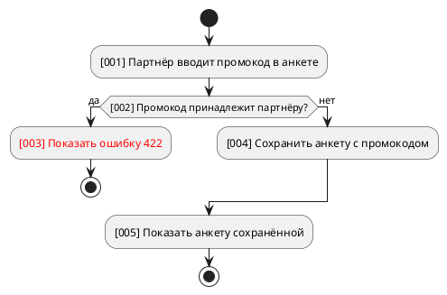

# puml-activity

`<база>` — базовая директория этого скила, `<плагин>` = `<база>/../..`. Перед работой прочитай `<плагин>/shared/blocks/diagrams.md`.

## Когда применять

- Аналитик явно просит блок-схему: алгоритм внутри одного сервиса, где важны развилки, а не порядок вызовов между сервисами.

Не применять в ТЗ типа 1 по умолчанию: процессы там — `puml-sequence`; статусы сущности — `puml-state`.

## Каркас

## Соглашения

- Каждый шаг — `:[NNN] <кто> <что делает>;`, номера по возрастанию; условие — `if ([NNN] вопрос?) then (да)`.
- Новое (new, ещё не реализовано) — текст шага в `<color:red>…</color>`, без `#` перед именем цвета; реализованное не выделяется.
- Исполнители и экраны — из карты влияния и ролей BRD.
- Ветки — `if`/`elseif`/`else`/`endif`, цикл — `while`/`endwhile`, параллельно — `fork`/`fork again`/`end fork`.

## Чек-лист

- [ ] Каждая ветка заканчивается `stop` или сходится обратно.
- [ ] Каждый шаг описан в тексте под тем же номером.
- [ ] Нет исполнителей вне карты влияния и ролей BRD.
- [ ] Красным только нереализованное.

## Проверка

`python3 <плагин>/scripts/sa_puml.py check <путь к .puml>` — исправляй, пока не `OK`. Если `проверка: только структура`, скажи в итоге, что синтаксис PlantUML не проверен.
