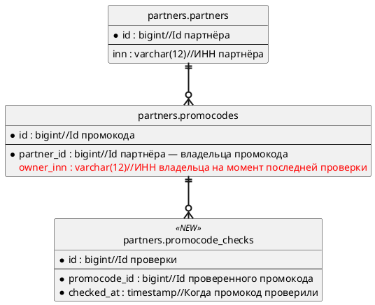

# puml-er

`<база>` — базовая директория этого скила, `<плагин>` = `<база>/../..`. Перед работой прочитай `<плагин>/shared/blocks/diagrams.md`.

## Когда применять

- В сервисе добавляются или меняются таблицы, поля или связи. Файл — `draft/diagrams/03-changes-er.puml` (у второго сервиса — `-2`), строка `@diagram` — в «3. БД» этого сервиса.

Не применять: поток данных между сервисами — `puml-c2`. Схема не меняется — диаграммы нет, в «3. БД» фраза «Изменений схемы БД не требуется — <причина>».

## Каркас

## Соглашения

- Имя сущности — `схема.таблица`; поля и типы — как в БД, из карты влияния, источника или решения `D-xx`.
- Только затронутые таблицы и прямые связи; у неизменных таблиц — ключи и поля связи.
- `*` — обязательное поле.
- У каждого поля, включая ключи, после типа через `//` — описание: что поле хранит, понятное без кода: `OriginalReceiptId : uuid//Id исходного чека, который заменяет этот`. Не повторяй имя поля словами («Id чека оригинального») и не пиши имена классов. У нового поля описание — внутри `<color:red>…</color>`.
- Новая таблица — стереотип `<<NEW>>` (фон LightGreen), новое поле в существующей таблице — `<color:red>…</color>`, без `#` перед именем цвета.
- Новое значение существующего enum — английское имя по стилю существующих значений рядом с русской подписью, с пометкой «предложено».
- Минимум пересечений: управляй порядком объявления сущностей и связей.

## Чек-лист

- [ ] Каждая таблица есть в карте влияния или источнике.
- [ ] Новые таблицы `<<NEW>>`, новые поля `<color:red>`, совпадают с «1. Описание изменений».
- [ ] Кардинальность связей указана.
- [ ] У каждого поля описание после `//`, понятное аналитику и тестировщику без кода.

## Проверка

`python3 <плагин>/scripts/sa_puml.py check <путь к .puml>` — исправляй, пока не `OK`. Если `проверка: только структура`, скажи в итоге, что синтаксис PlantUML не проверен.
