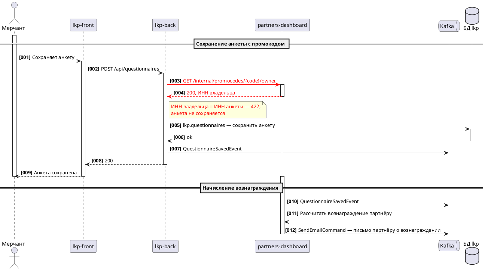

# puml-sequence

`<база>` — базовая директория этого скила, `<плагин>` = `<база>/../..`. Перед работой прочитай `<плагин>/shared/blocks/diagrams.md`.

## Когда применять

- Процесс, где важен порядок вызовов между пользователем, сервисами, БД и Kafka. Одна диаграмма — один процесс в `:::expand Процесс: <название>`.
- Только пользовательские сценарии, меняющие данные. Чтение списков и экранов и дубли того же сценария из БО не рисуются.

Не применять: структура системы — `puml-c2`; таблицы — `puml-er`.

## Каркас

## Соглашения

- Всегда `autonumber "<b>[000]"`; номера шагов в «Описании шагов» — те же.
- Несколько кейсов — в одной схеме разделами `== Раздел ==`. Внутри разделов **без** `alt`/`loop`/`opt`/`par`/`break`/`group`: ветки и ошибки (`403`/`422`) — заметками `note`.
- Участники — сервисы из карты влияния, роли из BRD (как их видит пользователь: «Страница приглашения (новая, публичная, без входа в ЛК)»), БД по схеме (`БД lkp`), конкретная таблица `схема.таблица` — в тексте стрелки, не в имени участника; Kafka — `queue`.
- Порядок участников слева направо — по графу смежности: связанные пары рядом, общий ресурс (БД) — с края. Стрелка не должна пересекать полосу активации участника, стоящего между отправителем и получателем: если пересекает — переставь участников.
- Текст стрелки по-русски, до двух строк. Вызов — метод и путь (`POST /internal/users/find`), не пересказ. БД — таблица `схема.таблица` и действие по-русски, без SQL, JSON и полей.
- Инициирующая стрелка — сплошная, ответ — пунктир. Стрелки — только из активированных линий: отправитель, который начинает сценарий или раздел (актор, фоновый процесс), активируется **до** своей первой стрелки; получатель — сразу после входящей.
- Kafka: сервис пишет — `Svc -> kafka: Событие`; сервис читает — `Svc --> kafka: Событие`. Стрелок `kafka -> Svc` нет, запись и чтение — две независимые стрелки.
- Фоновый процесс — стрелкой сервиса в себя («Фоновая проверка … раз в час»), отдельного участника «Фоновая проверка» нет.
- Самострелка последним действием перед `deactivate` рисуется криво: изменение данных — стрелкой в БД, отправка письма — командой в Kafka.
- Нельзя `deactivate X` и сразу `activate X` без сообщения на линии `X` (на границе разделов падает в Confluence): держи линию активной через границу.
- Новое (нет в коде, влияние `новый`/`изм.`) — `A [#red]-> B: <color:red>Текст</color>`, на каждую строку после `\n` — свой тег. Порядок существующих шагов — по коду (кто кого фактически вызывает), а не по порядку записей в артефактах. Если в обсуждении или решениях есть хоть одна деталь, противоречащая порядку по коду, — сначала `Q-SA` с обеими версиями, диаграмму не рисуй, пока аналитик не решит. Порядок новых шагов — по контексту обсуждения; неясно — `Q-SA`.

## Чек-лист

- [ ] Есть `autonumber "<b>[000]"`, нет `alt`/`loop`/`opt`.
- [ ] Нет участников вне карты влияния и ролей BRD.
- [ ] Ни одна стрелка не проходит через чужую полосу активации.
- [ ] На стрелках вызовов — реальные или спроектированные методы, не пересказ.
- [ ] Kafka только со стрелками от сервиса: запись сплошная, чтение пунктир.
- [ ] Красным только нереализованное, теги цвета валидны.
- [ ] Порядок существующих шагов совпадает с кодом; противоречия с обсуждением вынесены в `Q-SA` до отрисовки.

## Проверка

`python3 <плагин>/scripts/sa_puml.py check <путь к .puml>` — исправляй, пока не `OK`. Если `проверка: только структура`, скажи в итоге, что синтаксис PlantUML не проверен.
