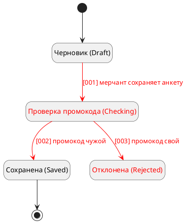

# puml-state

`<база>` — базовая директория этого скила, `<плагин>` = `<база>/../..`. Перед работой прочитай `<плагин>/shared/blocks/diagrams.md`.

## Когда применять

- Аналитик просит показать статусы сущности (анкета, платёж, заявка) и переходы между ними.

Не применять: последовательность вызовов — `puml-sequence`; алгоритм — `puml-activity`.

## Каркас

## Соглашения

- Статусы — кодовые имена enum из кода, карты влияния или источника в скобках, русская подпись — перед ними. Новое значение — английское имя по стилю существующих, помечено «предложено».
- На переходе — событие или условие и номер шага.
- Новое (new) — `<color:red>` в подписи статуса и `-[#red]->` на переходе; реализованное не выделяется.

## Чек-лист

- [ ] Из каждого статуса, кроме конечных, есть переход.
- [ ] Каждый переход описан в тексте.
- [ ] Новые статусы и переходы красные, у новых значений enum — английское имя.

## Проверка

`python3 <плагин>/scripts/sa_puml.py check <путь к .puml>` — исправляй, пока не `OK`. Если `проверка: только структура`, скажи в итоге, что синтаксис PlantUML не проверен.
